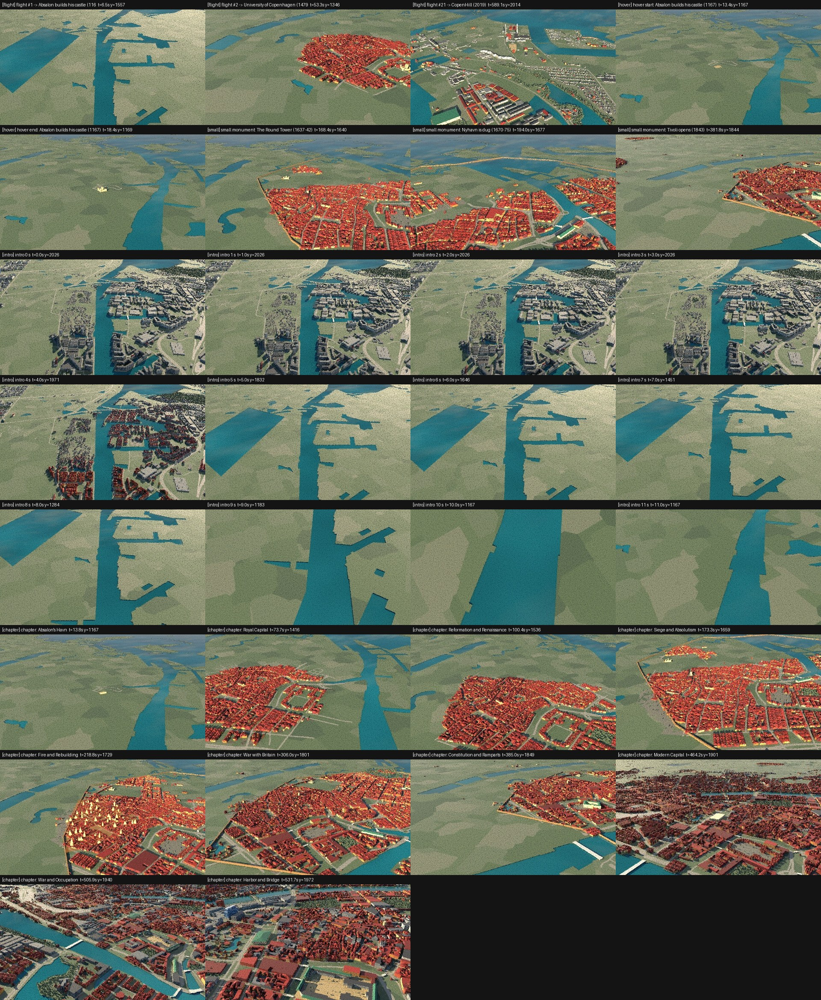
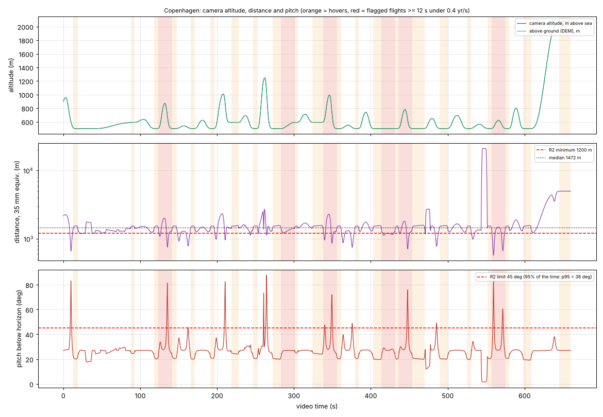
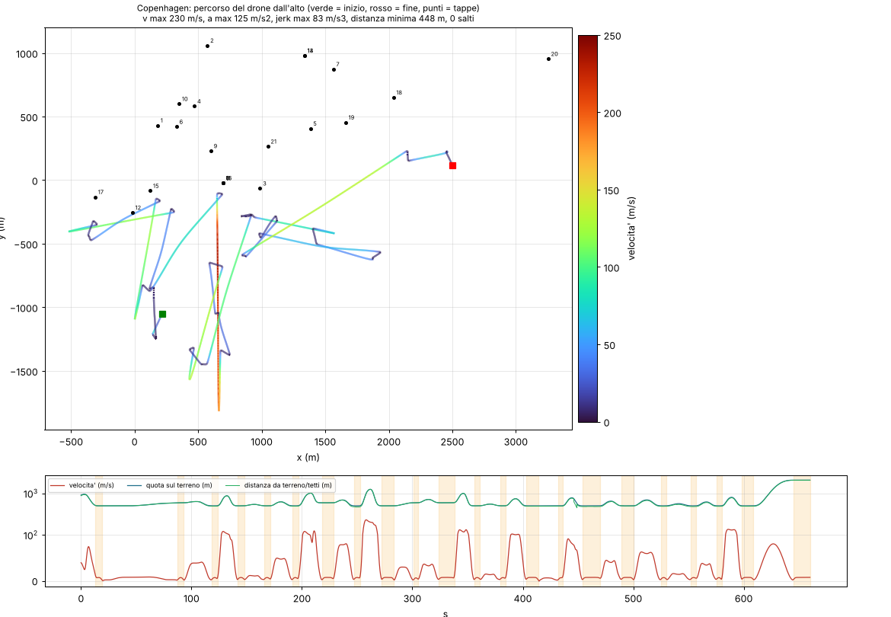
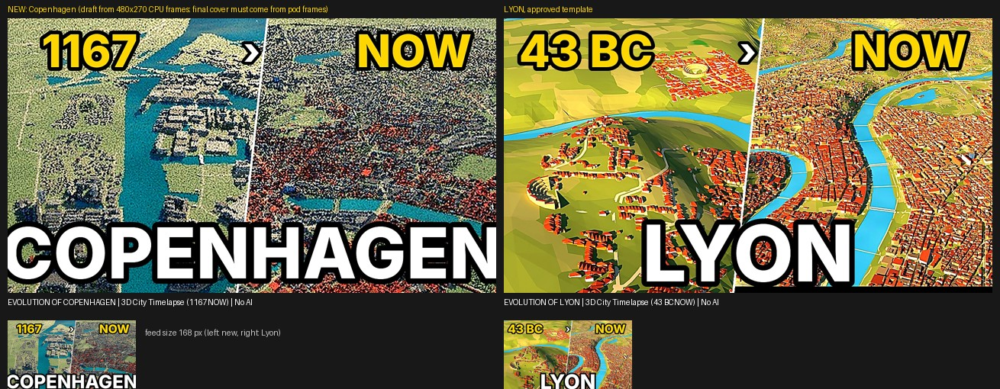

# GO dossier: Copenhagen (copenhagen)

Generated by `python -m kit gate copenhagen` on 2026-11-27 20:43 in 3544 s. **Overall: FAIL** (gate checks, including every kit qa FAIL) / kit qa alone: **WARN**. No pod before a written GO (R3).

## Verdict (R2)

- **PASS** R2 camera distance: median 1472 m (35 mm equiv.), minimum 1200; refs: Copenhagen 1397, Paris 1427
- **PASS** R2 look angle: p95 38 deg (limit 45), 96.9% of keys under it, max 88 deg
- **WARN** R2 frozen-counter flights: 6 flight(s) >= 12 s under 0.4 yr/s: #4 124-142 s (0.35); #10 283-301 s (0.06); #12 338-356 s (0.09); #15 414-432 s (0.17); #16 436-454 s (0.11); #20 557-575 s (0.14)
- **PASS** plots: plots.png
- **FAIL** POD PARITY: landphases_orig.json: missing on the pod  -> python -m kit pack copenhagen
- **PASS** contact sheet: 30/30 real local frames: contact_sheet.jpg
- **WARN** packaging draft: the left frame shows year 2026, the label says 1167: the frame must show the first year (Lyon's mistake); city json has no cover.shots: frames are a fallback (first hover / last flight second), define cover.shots
- **WARN** banner: branch yb/copenhagen-go has no upstream: not pushed
- **WARN** banner: 9 uncommitted changes that the pod will not see (e.g. M cities/copenhagen/story.json)

## 1. Contact sheet (real local CPU frames, 480x270)



Frames: flight:flight #1 -> Absalon builds his castle (116@6.5s; flight:flight #2 -> University of Copenhagen (1479@53.3s; flight:flight #21 -> CopenHill (2019)@589.1s; hover:hover start: Absalon builds his castle (1167)@13.4s; hover:hover end: Absalon builds his castle (1167)@18.4s; small:small monument: The Round Tower (1637-42)@168.4s; small:small monument: Nyhavn is dug (1670-75)@194.0s; small:small monument: Tivoli opens (1843)@381.8s; intro:intro 0 s@0.0s; intro:intro 1 s@1.0s; intro:intro 2 s@2.0s; intro:intro 3 s@3.0s; intro:intro 4 s@4.0s; intro:intro 5 s@5.0s; intro:intro 6 s@6.0s; intro:intro 7 s@7.0s; intro:intro 8 s@8.0s; intro:intro 9 s@9.0s; intro:intro 10 s@10.0s; intro:intro 11 s@11.0s; chapter:chapter: Absalon's Havn@13.8s; chapter:chapter: Royal Capital@73.7s; chapter:chapter: Reformation and Renaissance@100.4s; chapter:chapter: Siege and Absolutism@173.3s; chapter:chapter: Fire and Rebuilding@218.8s; chapter:chapter: War with Britain@306.0s; chapter:chapter: Constitution and Ramparts@385.0s; chapter:chapter: Modern Capital@464.2s; chapter:chapter: War and Occupation@505.9s; chapter:chapter: Harbor and Bridge@531.7s

## 2. Camera altitude, distance, pitch





Median distance 1472 m (>= 1200); pitch p95 38 deg (< 45); max pitch 88 deg.

## 3. Flight table

| # | start s | end s | dur s | years/s | median dist m | max alt m | max pitch deg | to | flag |
|---|---|---|---|---|---|---|---|---|---|
| 1 | 0.0 | 12.9 | 12.9 | 66.59 | 1926 | 954 | 83 | Absalon builds his castle (1167) | (opening) |
| 2 | 18.9 | 87.6 | 68.7 | 4.52 | 1304 | 591 | 30 | University of Copenhagen (1479) |  |
| 3 | 92.8 | 118.3 | 25.5 | 4.96 | 1446 | 633 | 27 | Rosenborg Castle (1606) |  |
| 4 | 123.7 | 141.7 | 18.0 | 0.35 | 1291 | 871 | 81 | Børsen and its dragon spire (1620- | **FLAG >= 12 s under 0.4 yr/s** |
| 5 | 147.7 | 165.7 | 18.0 | 0.62 | 1182 | 541 | 46 | The Round Tower (1637-42) |  |
| 6 | 171.1 | 191.3 | 20.2 | 1.40 | 1360 | 624 | 27 | Nyhavn is dug (1670-75) |  |
| 7 | 196.6 | 218.4 | 21.8 | 2.11 | 1458 | 1009 | 83 | The Great Fire (20-23 October 1728 |  |
| 8 | 228.4 | 246.9 | 18.6 | 1.25 | 1458 | 691 | 31 | Frederiksstaden: Amalienborg (1750 |  |
| 9 | 252.9 | 272.2 | 19.2 | 1.75 | 1501 | 1247 | 88 | Christiansborg burns (1794) |  |
| 10 | 283.2 | 301.2 | 18.0 | 0.06 | 1329 | 591 | 27 | Fire of 1795 (June 1795) | **FLAG >= 12 s under 0.4 yr/s** |
| 11 | 305.2 | 323.9 | 18.7 | 0.64 | 1567 | 712 | 27 | British bombardment (September 180 |  |
| 12 | 337.9 | 355.9 | 18.0 | 0.09 | 1289 | 995 | 72 | Christiansborg rises again (1803-2 | **FLAG >= 12 s under 0.4 yr/s** |
| 13 | 361.3 | 379.3 | 18.0 | 1.27 | 1185 | 550 | 49 | Tivoli opens (1843) |  |
| 14 | 384.3 | 402.9 | 18.6 | 1.69 | 1469 | 741 | 27 | Marble Church rebuilt (1874-94) |  |
| 15 | 413.9 | 432.1 | 18.2 | 0.17 | 1193 | 500 | 29 | The great dome (1894) | **FLAG >= 12 s under 0.4 yr/s** |
| 16 | 436.1 | 454.1 | 18.0 | 0.11 | 1286 | 781 | 76 | City Hall (1892-1905) | **FLAG >= 12 s under 0.4 yr/s** |
| 17 | 470.1 | 489.2 | 19.1 | 0.63 | 1504 | 649 | 49 | Christiansborg III and its tower ( |  |
| 18 | 500.0 | 524.8 | 24.8 | 1.20 | 1424 | 693 | 27 | SAS Royal, the first skyscraper in |  |
| 19 | 530.2 | 551.7 | 21.5 | 2.05 | 1348 | 563 | 34 | The Opera House (2005) |  |
| 20 | 557.1 | 575.1 | 18.0 | 0.14 | 1232 | 620 | 85 | Royal Playhouse (2008) | **FLAG >= 12 s under 0.4 yr/s** |
| 21 | 580.1 | 598.1 | 18.0 | 0.61 | 1542 | 801 | 28 | CopenHill (2019) |  |
| 22 | 608.5 | 645.0 | 36.5 | 0.16 | 3098 | 2071 | 38 | finale | (finale) |

## 4. kit qa

Result: **WARN** (full report: qa_REPORT.md)

- **WARN** d) centro storico molto grande: raster limitato a 10 km
- **WARN** d) 1800: 7 aree vuote allungate: #1 722x154 m a (55.66989,12.53704); #2 361x69 m a (55.66587,12.51429); #3 532x128 m a (55.66442,12.51919); #4 575x118 m a (55.66231,12.51113); #5 483x102 m a (55.66026,12.52168); #6 176x36 m a (55.66021,12.51155) — corridoi_1800.png
- **WARN** d) 1800: 1 viali larghi gia' visibili (se aperti sventrando: gutting): #8 709x67 m a (55.66091,12.51664)
- **WARN** d) 1900: 20 aree vuote allungate: #1 213x46 m a (55.66904,12.54328); #2 235x29 m a (55.66659,12.55568); #3 160x25 m a (55.66652,12.55488); #4 145x26 m a (55.66571,12.51827); #5 297x48 m a (55.66446,12.52060); #6 258x26 m a (55.66345,12.52136) — corridoi_1900.png
- **WARN** d) 1900: 5 viali larghi gia' visibili (se aperti sventrando: gutting): #21 846x56 m a (55.65789,12.54797); #22 738x87 m a (55.66113,12.51613); #23 623x46 m a (55.65420,12.54679); #24 295x30 m a (55.66384,12.51161); #25 264x44 m a (55.66822,12.54574)
- **WARN** d) 1950: 191 aree vuote allungate: #1 252x62 m a (55.66991,12.45977); #2 157x28 m a (55.67072,12.48281); #3 157x28 m a (55.67029,12.51304); #4 182x28 m a (55.66953,12.45735); #5 165x39 m a (55.66929,12.47577); #6 144x34 m a (55.66936,12.53892) — corridoi_1950.png
- **WARN** e) drone: soste tolte per tempo: 3 tolte, 21 tenute, 0 solo sorvolate; hover 157 s, volo 475 s; The Øresund Bridge (2000) (1996); Grundtvig Church (1921-40) (1929); Christiansborg burns again (1885)
- **WARN** e) drone: voli con gli anni quasi fermi: 124-142 s (18 s, 0.35 anni/s) verso 'Børsen and its dragon spir'; 283-301 s (18 s, 0.06 anni/s) verso 'Fire of 1795 (June 1795)'; 338-356 s (18 s, 0.09 anni/s) verso 'Christiansborg rises again'; 414-432 s (18 s, 0.17 anni/s) verso 'The great dome (1894)'; 436-454 s (18 s, 0.11 anni/s) verso 'City Hall (1892-1905)'; 557-575 s (18 s, 0.14 anni/s) verso 'Royal Playhouse (2008)'  [uniscili: trasforma una delle due soste vicine in cartello]
- **WARN** e) ritmo: nessun vuoto > 15 s senza stimolo nuovo: vuoto massimo 26.4 s (330-356 s); 14 oltre 15 s: 13-30, 100-118, 118-142, 142-166, 200-218, 254-272

## 5. Expected pod banner (quote it in the GO message)

```
VERSIONE: 3d23f84 Copenaghen: build locale con kit nuovo (stub hist_cph_kit, regia v_leg/t_leg_min/rate_cap, card_look, finale), qa e/regia senza FAIL | schedule_copenhagen: 660 s, lens 32.0
```

Branch `yb/copenhagen-go`. The GO message must contain, in ONE message: GPU check (`cuInit` = 0), `git pull` + this banner to verify, the launch command, the live progress one-liner, covers, and the condition to switch off (R3).

- WARN branch yb/copenhagen-go has no upstream: not pushed
- WARN 9 uncommitted changes that the pod will not see (e.g. M cities/copenhagen/story.json)

## 6. Cost (measured basis only, R4)

- Measured basis (Lyon, 16/11/2026) [Certain]: 29 pod-s per video-s (4 h 37 min real render / 565 s = 29.4), +30 min scene build per process (145K building groups), pod about 0.5 EUR/h [Likely: over 5 EUR for about 10 h].
- This city: video 11 min 00 s (660 s), 2 process(es) (day + night), buildings 131,817.
- Estimate scaled from Lyon [Likely]: render 5 h 19 min + scene build 1 h 00 min = **6 h 19 min of pod, about 3.2 EUR**. Say it as an estimate.
- Over 100K buildings: no separate preview, go straight to `full`, check the first frames, re-render only a bad segment (R3).

## 7. Packaging (R14: series formula)

- Title: `EVOLUTION OF COPENHAGEN | 3D City Timelapse (1167–NOW) | No AI`
- Lyon title (approved): `EVOLUTION OF LYON | 3D City Timelapse (43 BC–NOW) | No AI`
- Thumbnail: `1167 > NOW`, city name `COPENHAGEN`, two full halves, no flag.
- First-year hover frame and NOW frame come from the city json `cover.shots`; the draft is built from 480x270 CPU frames, the final cover is rendered on the pod frames.


- WARN the left frame shows year 2026, the label says 1167: the frame must show the first year (Lyon's mistake)
- WARN city json has no cover.shots: frames are a fallback (first hover / last flight second), define cover.shots

