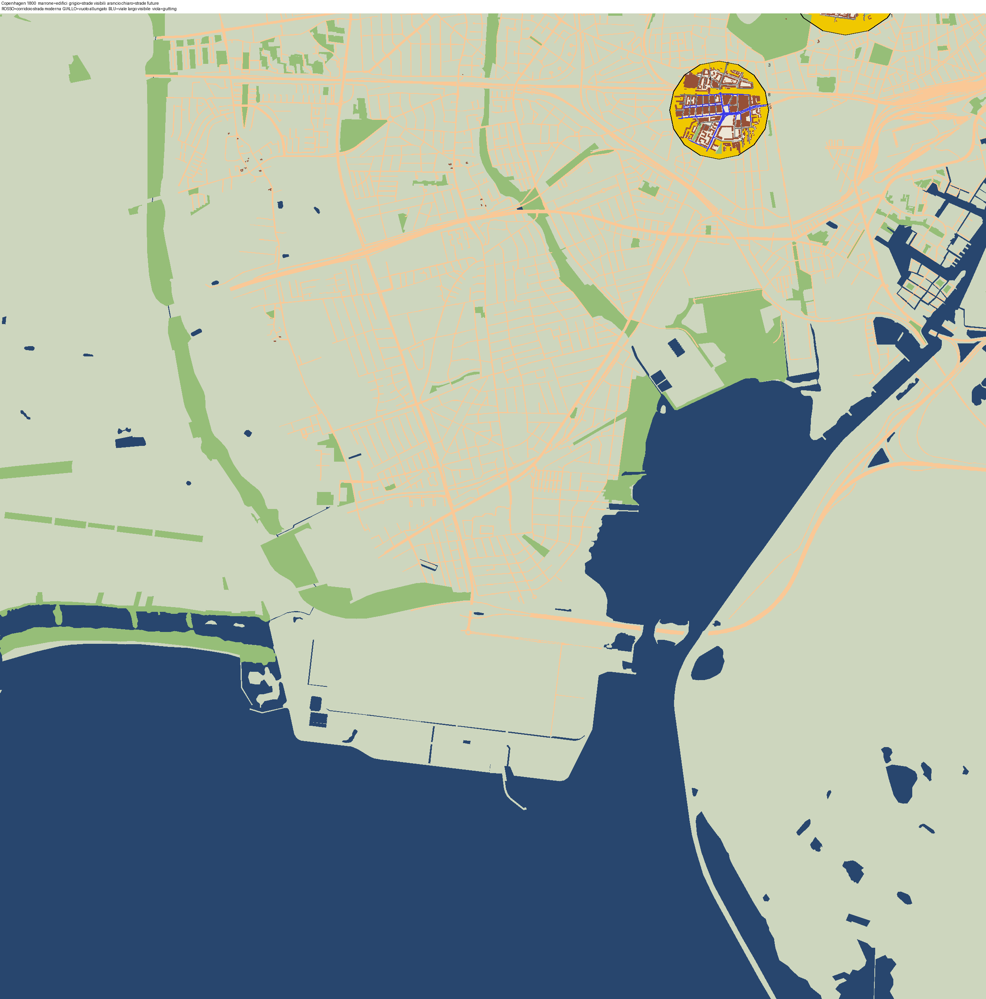

# QA copenhagen

Generato da `python -m kit.qa` il 2026-11-27 18:34. Esito complessivo: **WARN**

| Sezione | Esito |
|---|---|
| a) Story e fonti | PASS |
| b) DATA | PASS |
| c) Densita' storica | PASS |
| d) Corridoi vuoti | WARN |
| e) Costo e schedule | WARN |

## a) Story e fonti

- **PASS** chiavi city
- **PASS** 54 fonti
- **PASS** date con fonte

## b) DATA

- **PASS** cartella DATA
  - data_copenhagen
- **PASS** buildings.json
  - 131938 voci
- **PASS** roads.json
  - 128234 voci
- **PASS** hist.json
  - 135503 voci
- **PASS** land.json
  - 179 voci
- **PASS** landmarks.json
  - 657 voci
- **PASS** dem.npz
- **PASS** anni edifici (131938)
  - senza anno 0, anno 0 (segnaposto): 0, dopo 2026: 0, prima di 1167 (compaiono all'inizio): 4, d<=y: 0, ring<3: 0
- **PASS** hist (135503 predecessori)
  - senza y/d 0, d<y 0, nati dopo 2026: 0
- **PASS** anni strade (128234 nastri)
  - senza anno 0, dopo 2026: 0; visibili all'inizio 99, nel 1800 10117

## c) Densita' storica

- **PASS** Medieval city, band to 250 m nel 1500
  - 730 edifici vivi (38/ha, copertura 48%) contro 364 (19/ha, copertura 53%) nel 2026: rapporto 2.01
- **PASS** Medieval city, band to 250 m nel 1800
  - 425 edifici vivi (22/ha, copertura 34%) contro 364 (19/ha, copertura 53%) nel 2026: rapporto 1.17
- **PASS** Medieval city, band to 450 m nel 1500
  - 2381 edifici vivi (39/ha, copertura 47%) contro 814 (13/ha, copertura 67%) nel 2026: rapporto 2.93
- **PASS** Medieval city, band to 450 m nel 1800
  - 1640 edifici vivi (27/ha, copertura 42%) contro 814 (13/ha, copertura 67%) nel 2026: rapporto 2.01
- **PASS** Medieval city, band to 650 m nel 1500
  - 3699 edifici vivi (37/ha, copertura 43%) contro 1118 (11/ha, copertura 57%) nel 2026: rapporto 3.31
- **PASS** Medieval city, band to 650 m nel 1800
  - 2626 edifici vivi (26/ha, copertura 41%) contro 1118 (11/ha, copertura 57%) nel 2026: rapporto 2.35
- **PASS** Medieval city, band to 900 m nel 1800
  - 3057 edifici vivi (26/ha, copertura 39%) contro 1214 (10/ha, copertura 53%) nel 2026: rapporto 2.52
- **PASS** Medieval city, band to 1200 m nel 1800
  - 3253 edifici vivi (25/ha, copertura 37%) contro 1276 (10/ha, copertura 50%) nel 2026: rapporto 2.55
- **PASS** Medieval city, outer part (to 1620) nel 1800
  - 3510 edifici vivi (25/ha, copertura 37%) contro 1331 (9/ha, copertura 49%) nel 2026: rapporto 2.64
- **PASS** Ny-Kobenhavn (Christian IV extension: Rosenborg, Nyboder) nel 1800
  - 1442 edifici vivi (23/ha, copertura 25%) contro 567 (9/ha, copertura 28%) nel 2026: rapporto 2.54
- **PASS** Nyhavn quarter nel 1800
  - 565 edifici vivi (17/ha, copertura 23%) contro 242 (7/ha, copertura 27%) nel 2026: rapporto 2.33
- **PASS** Frederiksstaden nel 1800
  - 1641 edifici vivi (16/ha, copertura 26%) contro 681 (7/ha, copertura 27%) nel 2026: rapporto 2.41
- **PASS** Christianshavn nel 1800
  - 2187 edifici vivi (20/ha, copertura 20%) contro 856 (8/ha, copertura 22%) nel 2026: rapporto 2.55
- **PASS** Holmen naval base nel 1800
  - 1172 edifici vivi (11/ha, copertura 12%) contro 264 (2/ha, copertura 14%) nel 2026: rapporto 4.44

## d) Corridoi vuoti

- **WARN** centro storico molto grande: raster limitato a 10 km
- **PASS** 1267: nessun corridoio vuoto
  - corridoi_1267.png
- **WARN** 1800: 7 aree vuote allungate
  - #1 722x154 m a (55.66989,12.53704); #2 361x69 m a (55.66587,12.51429); #3 532x128 m a (55.66442,12.51919); #4 575x118 m a (55.66231,12.51113); #5 483x102 m a (55.66026,12.52168); #6 176x36 m a (55.66021,12.51155) — corridoi_1800.png
- **WARN** 1800: 1 viali larghi gia' visibili (se aperti sventrando: gutting)
  - #8 709x67 m a (55.66091,12.51664)
- **WARN** 1900: 20 aree vuote allungate
  - #1 213x46 m a (55.66904,12.54328); #2 235x29 m a (55.66659,12.55568); #3 160x25 m a (55.66652,12.55488); #4 145x26 m a (55.66571,12.51827); #5 297x48 m a (55.66446,12.52060); #6 258x26 m a (55.66345,12.52136) — corridoi_1900.png
- **WARN** 1900: 5 viali larghi gia' visibili (se aperti sventrando: gutting)
  - #21 846x56 m a (55.65789,12.54797); #22 738x87 m a (55.66113,12.51613); #23 623x46 m a (55.65420,12.54679); #24 295x30 m a (55.66384,12.51161); #25 264x44 m a (55.66822,12.54574)
- **WARN** 1950: 191 aree vuote allungate
  - #1 252x62 m a (55.66991,12.45977); #2 157x28 m a (55.67072,12.48281); #3 157x28 m a (55.67029,12.51304); #4 182x28 m a (55.66953,12.45735); #5 165x39 m a (55.66929,12.47577); #6 144x34 m a (55.66936,12.53892) — corridoi_1950.png

## e) Costo e schedule

- **PASS** costo dei cambi (9 s)
  - oggetti citta' 3387, cambi in tutto il video 120655, max in un fotogramma 1084 (~13 s), costo dei soli cambi ~0.40 h (budget 1.0 h)
- **PASS** drone: velocita' massima
  - 230 m/s (limite 250), mediana 11
- **PASS** drone: accelerazione massima
  - 125 m/s2 (limite 120), 99% 69
- **PASS** drone: jerk massimo
  - 83 m/s3 (limite 200), 99% 50
- **PASS** drone: distanza minima da terreno e tetti
  - 448 m (soglia 24); dal solo terreno 500 m
- **PASS** drone: discontinuita' (target 0, tagli dichiarati: 0)
  - 0 salti
- **WARN** drone: soste tolte per tempo
  - 3 tolte, 21 tenute, 0 solo sorvolate; hover 157 s, volo 475 s; The Øresund Bridge (2000) (1996); Grundtvig Church (1921-40) (1929); Christiansborg burns again (1885)
- **PASS** drone: hover quasi fermo
  - v max in hover 8.2 m/s (soglia 12; esclusi 30% o 1,5 s a ogni estremo)
- **WARN** drone: voli con gli anni quasi fermi
  - 124-142 s (18 s, 0.35 anni/s) verso 'Børsen and its dragon spir'; 283-301 s (18 s, 0.06 anni/s) verso 'Fire of 1795 (June 1795)'; 338-356 s (18 s, 0.09 anni/s) verso 'Christiansborg rises again'; 414-432 s (18 s, 0.17 anni/s) verso 'The great dome (1894)'; 436-454 s (18 s, 0.11 anni/s) verso 'City Hall (1892-1905)'; 557-575 s (18 s, 0.14 anni/s) verso 'Royal Playhouse (2008)'  [uniscili: trasforma una delle due soste vicine in cartello]
- **PASS** drone: monumenti visibili durante il loro hover
  - ogni monumento bersaglio ha il corpo costruito a meta' hover  [Confluences: il corpo compariva a fine hover]
- **PASS** drone: distanza della camera
  - mediana 1472 m equivalenti a 35 mm (obiettivo 32 mm); riferimenti: Copenaghen 1397, Parigi 1427, Madrid 2538, Lione 930 (giudicata troppo vicina); soglia 1200
- **PASS** drone: esattezza anni
  - soste: y0 e y1 esatti sulla finestra di hover; cartelli fuori hover esatti; cartelli durante un hover e voli: anni flessibili (il contatore scorre fra le voci)
- **PASS** drone: grafico del percorso
  - qa/drone_path.png
- **WARN** ritmo: nessun vuoto > 15 s senza stimolo nuovo
  - vuoto massimo 26.4 s (330-356 s); 14 oltre 15 s: 13-30, 100-118, 118-142, 142-166, 200-218, 254-272
- **PASS** ritmo: anni/s per minuto
  - 0:00 10.97 | 1:00  4.00 | 2:00  0.87 | 3:00  1.52 | 4:00  0.73 | 5:00  0.37 | 6:00  1.12 | 7:00  0.50 | 8:00  1.32 | 9:00  0.43 | 10:00  0.11
- **PASS** 24 soste ben formate
- **PASS** soste ordinate e non sovrapposte
- **PASS** didascalie "Titolo (data)"
- **PASS** soste e cartelli sugli anni della story (0,01)
- **PASS** evento forte entro 45 s
  - primo a 12.9 s
- **PASS** notte
  - night_t=645.0, schedule_copenhagen_night.json ok

## Immagini

