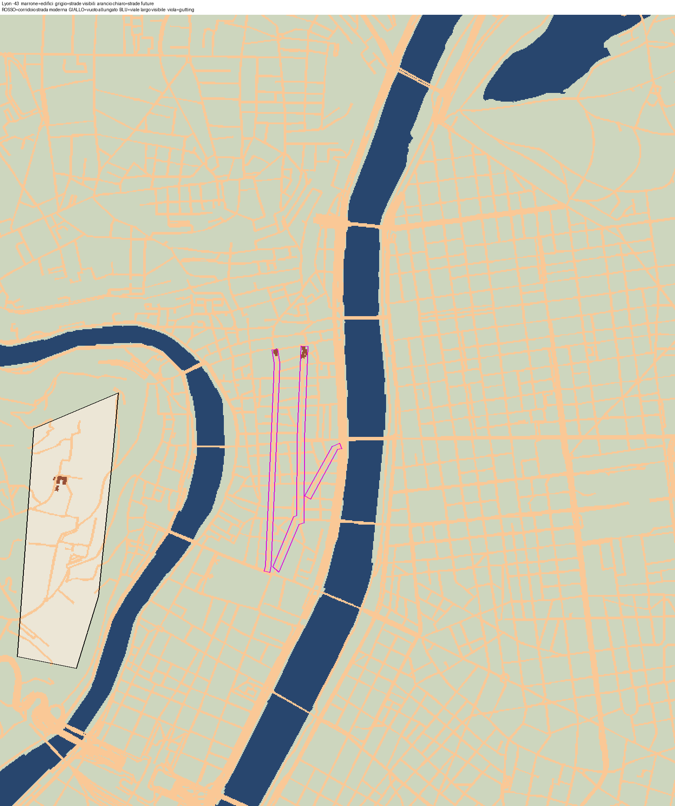
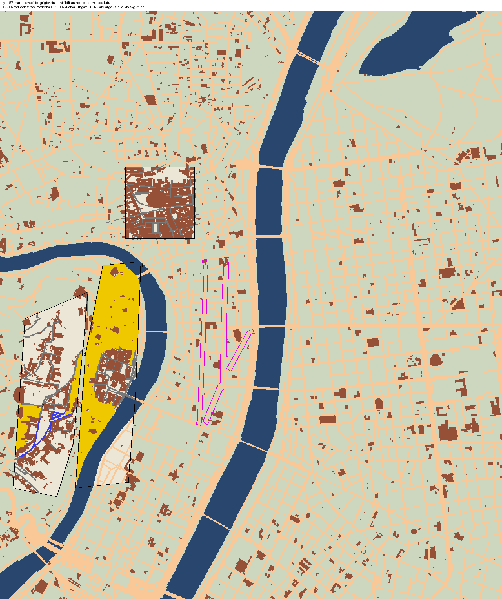
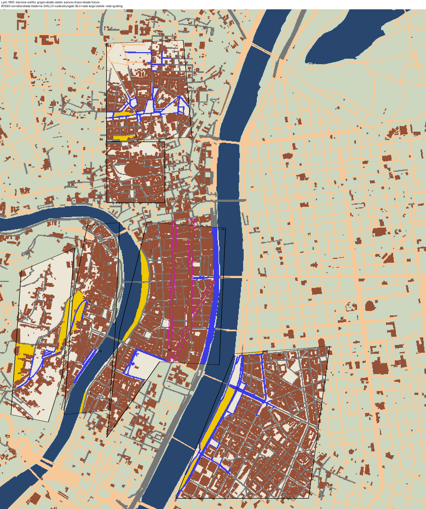
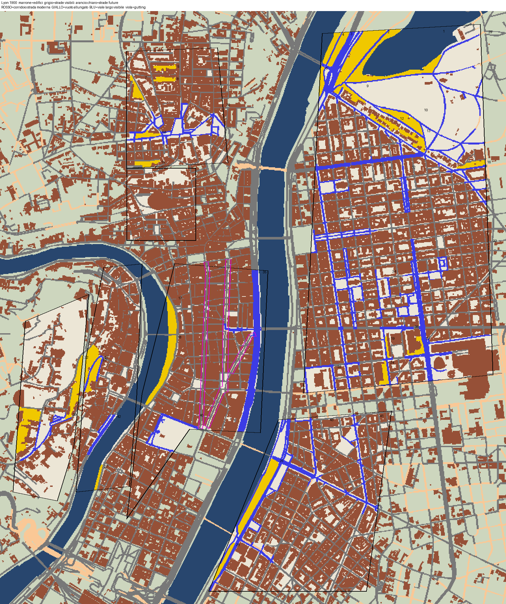
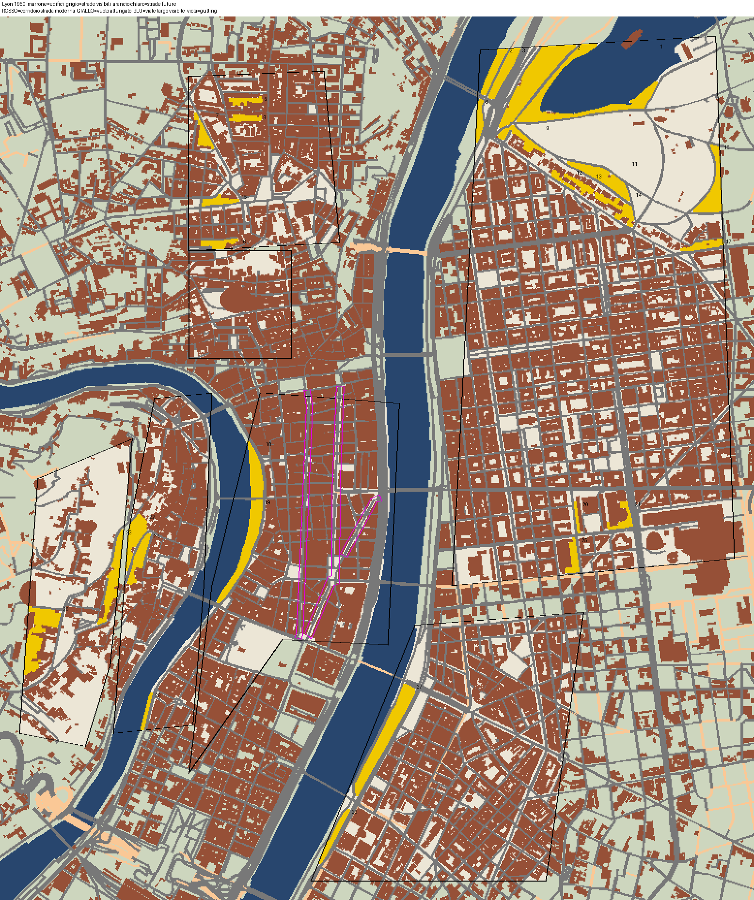

# QA lyon

Generato da `python -m kit.qa` il 2026-11-13 14:58. Esito complessivo: **WARN**

| Sezione | Esito |
|---|---|
| a) Story e fonti | PASS |
| b) DATA | PASS |
| c) Densita' storica | PASS |
| d) Corridoi vuoti | WARN |
| e) Costo e schedule | WARN |

## a) Story e fonti

- **PASS** chiavi city
- **PASS** 19 fonti
- **PASS** date con fonte

## b) DATA

- **PASS** cartella DATA
  - data_lyon
- **PASS** buildings.json
  - 145881 voci
- **PASS** roads.json
  - 314058 voci
- **PASS** hist.json
  - 12967 voci
- **PASS** land.json
  - 52 voci
- **PASS** landmarks.json
  - 362 voci
- **PASS** dem.npz
- **PASS** anni edifici (145881)
  - senza anno 0, dopo 2026: 0, prima di -43 (compaiono all'inizio): 0, d<=y: 0, ring<3: 0
- **PASS** hist (12967 predecessori)
  - senza y/d 0, d<y 0, nati dopo 2026: 0
- **PASS** anni strade (314058 nastri)
  - senza anno 0, dopo 2026: 0; visibili all'inizio 205, nel 1800 26442

## c) Densita' storica

- **PASS** Roman Lugdunum on Fourvière nel 1500
  - 545 edifici vivi (13/ha, copertura 17%) contro 270 (7/ha, copertura 20%) nel 2026: rapporto 2.02
- **PASS** Roman Lugdunum on Fourvière nel 1800
  - 513 edifici vivi (13/ha, copertura 17%) contro 270 (7/ha, copertura 20%) nel 2026: rapporto 1.90
- **PASS** Roman Condate and Three Gauls slope nel 1500
  - 662 edifici vivi (35/ha, copertura 50%) contro 523 (28/ha, copertura 53%) nel 2026: rapporto 1.27
- **PASS** Roman Condate and Three Gauls slope nel 1800
  - 651 edifici vivi (34/ha, copertura 51%) contro 523 (28/ha, copertura 53%) nel 2026: rapporto 1.24
- **PASS** Saône valley (Vieux-Lyon) nel 1500
  - 1109 edifici vivi (26/ha, copertura 40%) contro 689 (16/ha, copertura 42%) nel 2026: rapporto 1.61
- **PASS** Saône valley (Vieux-Lyon) nel 1800
  - 929 edifici vivi (22/ha, copertura 41%) contro 689 (16/ha, copertura 42%) nel 2026: rapporto 1.35
- **PASS** Medieval Presqu'île nel 1500
  - 2729 edifici vivi (35/ha, copertura 47%) contro 968 (13/ha, copertura 46%) nel 2026: rapporto 2.82
- **PASS** Medieval Presqu'île nel 1800
  - 2457 edifici vivi (32/ha, copertura 48%) contro 968 (13/ha, copertura 46%) nel 2026: rapporto 2.54
- **PASS** Guillotière faubourg nel 1800
  - 2471 edifici vivi (28/ha, copertura 42%) contro 1239 (14/ha, copertura 44%) nel 2026: rapporto 1.99

## d) Corridoi vuoti

- **PASS** -43: nessun corridoio vuoto
  - corridoi_-43.png
- **WARN** 57: 3 aree vuote allungate
  - #1 1189x178 m a (45.76101,4.82660); #2 347x36 m a (45.76033,4.82384); #3 287x63 m a (45.75796,4.82024) — corridoi_57.png
- **WARN** 57: 1 viali larghi gia' visibili (se aperti sventrando: gutting)
  - #4 381x22 m a (45.75758,4.82158)
- **WARN** 1800: 12 aree vuote allungate
  - #1 140x27 m a (45.77438,4.82969); #2 137x29 m a (45.77276,4.82961); #3 209x46 m a (45.76434,4.83154); #4 440x37 m a (45.76129,4.83072); #5 201x48 m a (45.76161,4.82521); #6 347x36 m a (45.76033,4.82384) — corridoi_1800.png
- **WARN** 1800: 8 viali larghi gia' visibili (se aperti sventrando: gutting)
  - #13 1085x51 m a (45.75376,4.83927); #14 967x45 m a (45.76235,4.83736); #15 561x40 m a (45.77498,4.83188); #16 381x22 m a (45.75758,4.82158); #17 313x31 m a (45.75779,4.83157)
- **WARN** 1900: 28 aree vuote allungate
  - #1 600x47 m a (45.77876,4.84919); #2 394x78 m a (45.77864,4.84653); #3 231x36 m a (45.77912,4.84478); #4 209x31 m a (45.77918,4.84424); #5 139x23 m a (45.77809,4.83103); #6 165x26 m a (45.77735,4.84344) — corridoi_1900.png
- **WARN** 1900: 15 viali larghi gia' visibili (se aperti sventrando: gutting)
  - #29 1278x41 m a (45.76651,4.84524); #30 1258x85 m a (45.77533,4.84986); #31 1100x50 m a (45.75379,4.83927); #32 955x47 m a (45.76235,4.83718); #33 817x58 m a (45.76461,4.85310)
- **WARN** 1950: 29 aree vuote allungate
  - #1 600x47 m a (45.77876,4.84919); #2 394x78 m a (45.77864,4.84653); #3 231x36 m a (45.77912,4.84478); #4 209x31 m a (45.77918,4.84424); #5 139x23 m a (45.77809,4.83103); #6 165x26 m a (45.77735,4.84344) — corridoi_1950.png

## e) Costo e schedule

- **PASS** costo dei cambi (6 s)
  - oggetti citta' 1706, cambi in tutto il video 46459, max in un fotogramma 309 (~4 s), costo dei soli cambi ~0.15 h (budget 1.0 h)
- **PASS** drone: velocita' massima
  - 208 m/s (limite 250), mediana 27
- **PASS** drone: accelerazione massima
  - 116 m/s2 (limite 120), 99% 53
- **PASS** drone: jerk massimo
  - 166 m/s3 (limite 200), 99% 43
- **PASS** drone: distanza minima da terreno e tetti
  - 30 m (soglia 24); dal solo terreno 80 m
- **PASS** drone: discontinuita' (target 0, tagli dichiarati: 0)
  - 0 salti
- **PASS** drone: soste tolte per tempo
  - 0 tolte, 22 tenute, 0 solo sorvolate; hover 195 s, volo 542 s; 
- **PASS** drone: hover quasi fermo
  - v max in hover 6.8 m/s (soglia 12; esclusi 30% o 1,5 s a ogni estremo)
- **PASS** drone: esattezza anni
  - soste: y0 e y1 esatti sulla finestra di hover; cartelli fuori hover esatti; cartelli durante un hover e voli: anni flessibili (il contatore scorre fra le voci)
- **PASS** drone: grafico del percorso
  - qa/drone_path.png
- **WARN** ritmo: nessun vuoto > 15 s senza stimolo nuovo
  - vuoto massimo 44.3 s (371-416 s); 13 oltre 15 s: 56-96, 166-186, 186-202, 249-286, 292-330, 343-371
- **PASS** ritmo: anni/s per minuto
  - 0:00 30.81 | 1:00 21.45 | 2:00  5.50 | 3:00  0.67 | 4:00  0.31 | 5:00  0.06 | 6:00  0.34 | 7:00  1.13 | 8:00  0.10 | 9:00  0.41 | 10:00  0.55 | 11:00  0.27 | 12:00  0.03 | 13:00  0.00
- **PASS** 22 soste ben formate
- **PASS** soste ordinate e non sovrapposte
- **PASS** didascalie "Titolo (data)"
- **PASS** soste e cartelli sugli anni della story (0,01)
- **PASS** evento forte entro 45 s
  - primo a 12.9 s
- **PASS** notte
  - night_t=749.5690295360679, schedule_lyon_night.json ok

## Immagini

