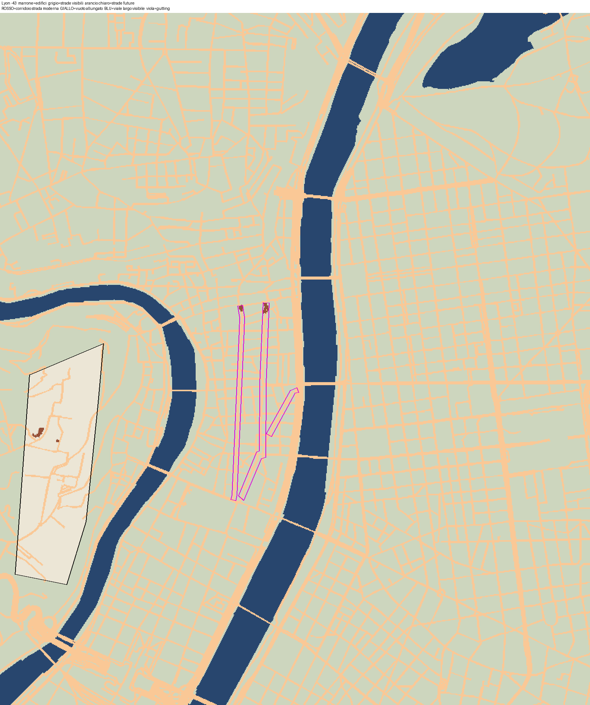
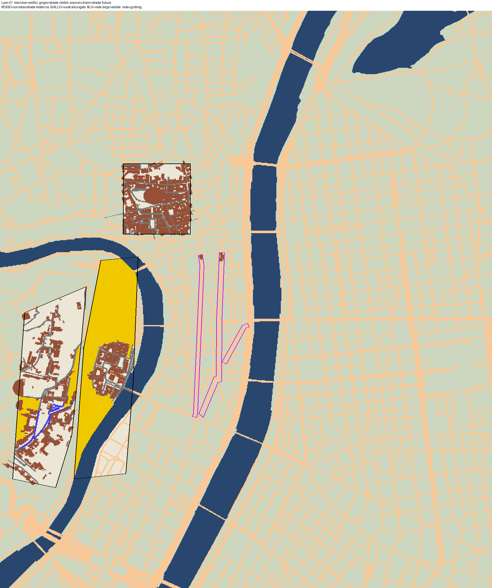
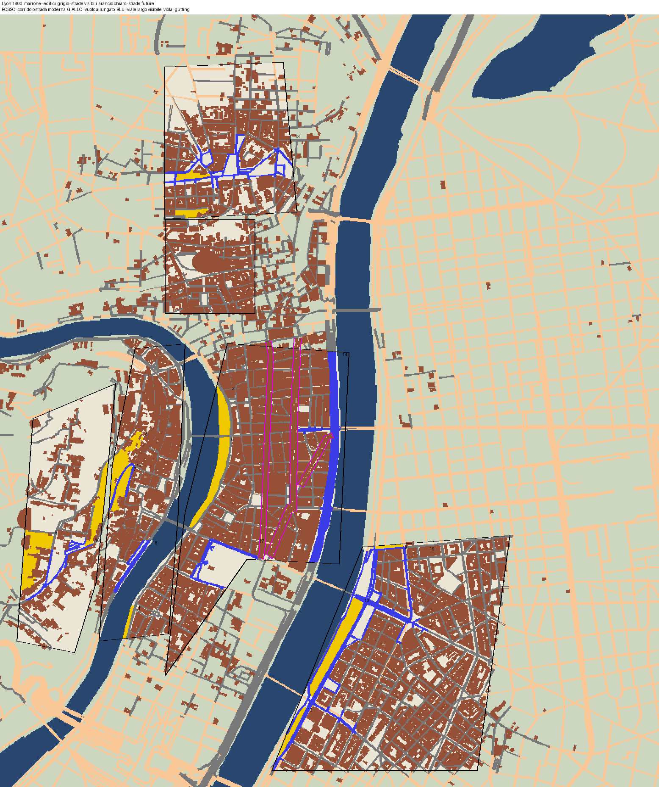
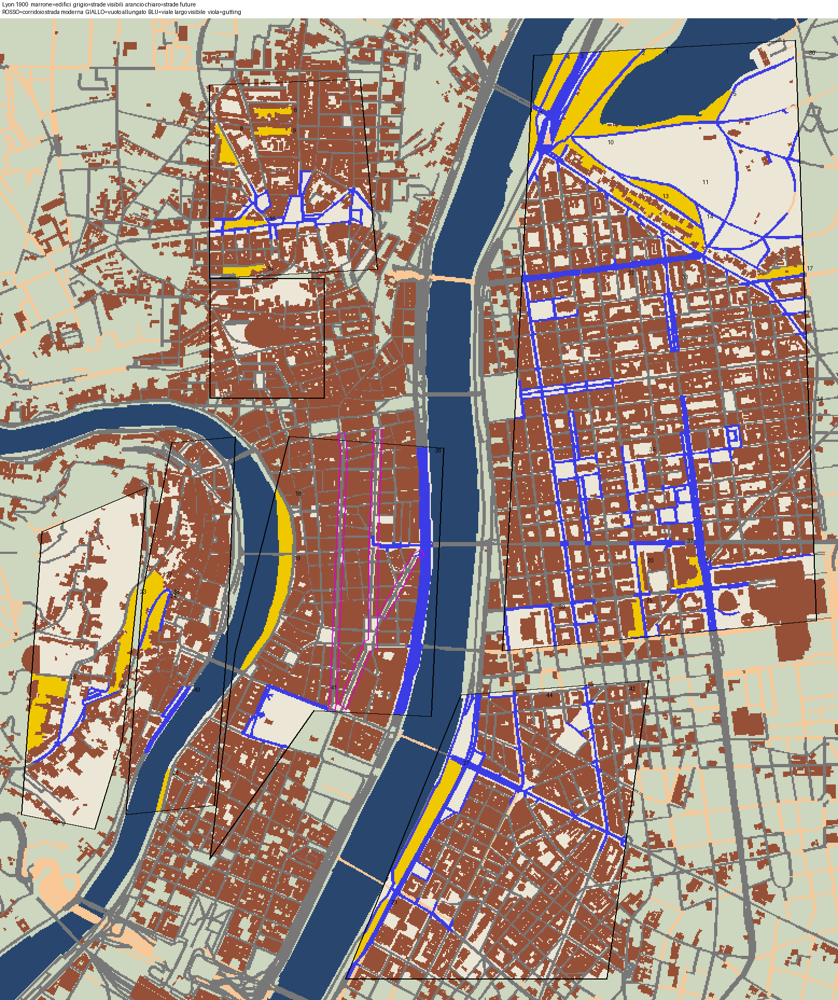
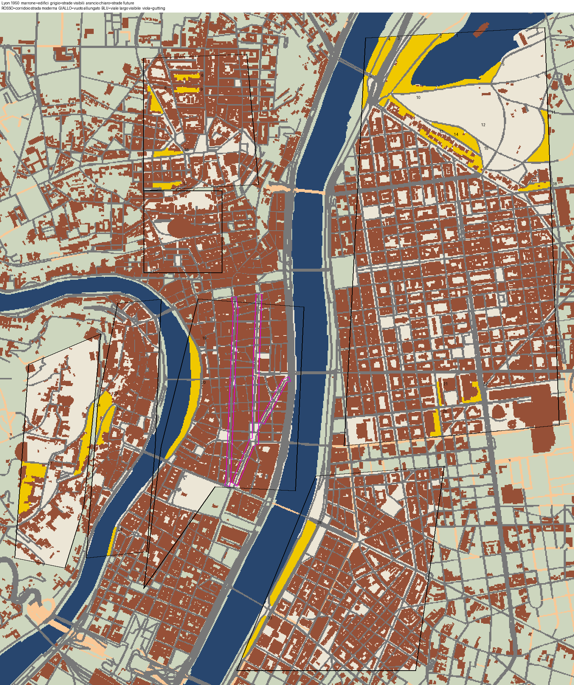

# QA lyon

Generato da `python -m kit.qa` il 2026-11-15 17:55. Esito complessivo: **WARN**

| Sezione | Esito |
|---|---|
| a) Story e fonti | PASS |
| b) DATA | PASS |
| c) Densita' storica | PASS |
| d) Corridoi vuoti | WARN |
| e) Costo e schedule | WARN |

## a) Story e fonti

- **PASS** chiavi city
- **PASS** 19 fonti
- **PASS** date con fonte

## b) DATA

- **PASS** cartella DATA
  - data_lyon
- **PASS** buildings.json
  - 145881 voci
- **PASS** roads.json
  - 314842 voci
- **PASS** hist.json
  - 14263 voci
- **PASS** land.json
  - 52 voci
- **PASS** landmarks.json
  - 362 voci
- **PASS** dem.npz
- **PASS** anni edifici (145881)
  - senza anno 0, anno 0 (segnaposto): 0, dopo 2026: 0, prima di -43 (compaiono all'inizio): 0, d<=y: 0, ring<3: 0
- **PASS** hist (14263 predecessori)
  - senza y/d 0, d<y 0, nati dopo 2026: 0
- **PASS** anni strade (314842 nastri)
  - senza anno 0, dopo 2026: 0; visibili all'inizio 205, nel 1800 23234

## c) Densita' storica

- **PASS** Roman Lugdunum on Fourvière nel 1500
  - 688 edifici vivi (17/ha, copertura 17%) contro 270 (7/ha, copertura 20%) nel 2026: rapporto 2.55
- **PASS** Roman Lugdunum on Fourvière nel 1800
  - 604 edifici vivi (15/ha, copertura 17%) contro 270 (7/ha, copertura 20%) nel 2026: rapporto 2.24
- **PASS** Roman Condate and Three Gauls slope nel 1500
  - 708 edifici vivi (37/ha, copertura 49%) contro 523 (28/ha, copertura 53%) nel 2026: rapporto 1.35
- **PASS** Roman Condate and Three Gauls slope nel 1800
  - 664 edifici vivi (35/ha, copertura 51%) contro 523 (28/ha, copertura 53%) nel 2026: rapporto 1.27
- **PASS** Saône valley (Vieux-Lyon) nel 1500
  - 1183 edifici vivi (28/ha, copertura 40%) contro 689 (16/ha, copertura 42%) nel 2026: rapporto 1.72
- **PASS** Saône valley (Vieux-Lyon) nel 1800
  - 980 edifici vivi (23/ha, copertura 41%) contro 689 (16/ha, copertura 42%) nel 2026: rapporto 1.42
- **PASS** Medieval Presqu'île nel 1500
  - 2859 edifici vivi (37/ha, copertura 47%) contro 968 (13/ha, copertura 46%) nel 2026: rapporto 2.95
- **PASS** Medieval Presqu'île nel 1800
  - 2574 edifici vivi (33/ha, copertura 47%) contro 968 (13/ha, copertura 46%) nel 2026: rapporto 2.66
- **PASS** Guillotière faubourg nel 1800
  - 2627 edifici vivi (29/ha, copertura 42%) contro 1239 (14/ha, copertura 44%) nel 2026: rapporto 2.12

## d) Corridoi vuoti

- **PASS** -43: nessun corridoio vuoto
  - corridoi_-43.png
- **WARN** 57: 3 aree vuote allungate
  - #1 1189x187 m a (45.76101,4.82660); #2 347x36 m a (45.76033,4.82384); #3 288x62 m a (45.75796,4.82024) — corridoi_57.png
- **WARN** 57: 1 viali larghi gia' visibili (se aperti sventrando: gutting)
  - #4 377x22 m a (45.75758,4.82158)
- **WARN** 1800: 12 aree vuote allungate
  - #1 143x27 m a (45.77438,4.82971); #2 137x29 m a (45.77276,4.82961); #3 209x46 m a (45.76434,4.83154); #4 289x45 m a (45.76199,4.82564); #5 440x37 m a (45.76129,4.83072); #6 347x36 m a (45.76033,4.82384) — corridoi_1800.png
- **WARN** 1800: 7 viali larghi gia' visibili (se aperti sventrando: gutting)
  - #13 1085x51 m a (45.75376,4.83927); #14 967x45 m a (45.76235,4.83736); #15 562x40 m a (45.77498,4.83188); #16 376x22 m a (45.75758,4.82158); #17 313x31 m a (45.75779,4.83157)
- **WARN** 1900: 29 aree vuote allungate
  - #1 461x39 m a (45.77876,4.84756); #2 394x78 m a (45.77864,4.84653); #3 230x36 m a (45.77912,4.84478); #4 209x31 m a (45.77918,4.84424); #5 338x31 m a (45.77817,4.85070); #6 139x23 m a (45.77809,4.83103) — corridoi_1900.png
- **WARN** 1900: 15 viali larghi gia' visibili (se aperti sventrando: gutting)
  - #30 1278x41 m a (45.76651,4.84524); #31 1257x84 m a (45.77533,4.84986); #32 1100x50 m a (45.75379,4.83927); #33 955x47 m a (45.76235,4.83718); #34 817x58 m a (45.76461,4.85310)
- **WARN** 1950: 30 aree vuote allungate
  - #1 461x39 m a (45.77876,4.84756); #2 394x78 m a (45.77864,4.84653); #3 230x36 m a (45.77912,4.84478); #4 209x31 m a (45.77918,4.84424); #5 338x31 m a (45.77817,4.85070); #6 139x23 m a (45.77809,4.83103) — corridoi_1950.png

## e) Costo e schedule

- **PASS** costo dei cambi (7 s)
  - oggetti citta' 1729, cambi in tutto il video 44925, max in un fotogramma 319 (~4 s), costo dei soli cambi ~0.15 h (budget 1.0 h)
- **PASS** drone: velocita' massima
  - 191 m/s (limite 250), mediana 21
- **PASS** drone: accelerazione massima
  - 106 m/s2 (limite 120), 99% 71
- **PASS** drone: jerk massimo
  - 159 m/s3 (limite 200), 99% 64
- **PASS** drone: distanza minima da terreno e tetti
  - 60 m (soglia 48); dal solo terreno 80 m
- **PASS** drone: discontinuita' (target 0, tagli dichiarati: 0)
  - 0 salti
- **PASS** drone: soste tolte per tempo
  - 0 tolte, 17 tenute, 0 solo sorvolate; hover 157 s, volo 380 s; 
- **PASS** drone: hover quasi fermo
  - v max in hover 9.1 m/s (soglia 12; esclusi 30% o 1,5 s a ogni estremo)
- **PASS** drone: voli con gli anni quasi fermi
  - nessun volo >= 12 s sotto 0,4 anni/s (fuori da apertura e finale)  [uniscili: trasforma una delle due soste vicine in cartello]
- **WARN** drone: monumenti visibili durante il loro hover
  - Saint-Jean Cathedral: corpo dal 1213.8, hover centrato su 1187.5  [accettato: Saint-Jean hover (1180-1195, 'cathedral is begun') shows the foundation only: the body appears at 1213.8. Accepted because the full render was already running (15/11); if the segment 96-102 s looks empty, set phases to y 1180 / y1 1190 and re-render frames ~2300-2500 only.]
- **WARN** drone: distanza della camera
  - mediana 930 m equivalenti a 35 mm (obiettivo 30 mm); riferimenti: Copenaghen 1397, Parigi 1427, Madrid 2538, Lione 930 (giudicata troppo vicina); soglia 1200
- **PASS** drone: esattezza anni
  - soste: y0 e y1 esatti sulla finestra di hover; cartelli fuori hover esatti; cartelli durante un hover e voli: anni flessibili (il contatore scorre fra le voci)
- **PASS** drone: grafico del percorso
  - qa/drone_path.png
- **WARN** ritmo: nessun vuoto > 15 s senza stimolo nuovo
  - vuoto massimo 43.0 s (306-349 s); 7 oltre 15 s: 56-96, 268-300, 306-349, 383-405, 420-440, 440-461
- **PASS** ritmo: anni/s per minuto
  - 0:00 30.81 | 1:00 21.45 | 2:00  5.63 | 3:00  0.85 | 4:00  0.32 | 5:00  1.21 | 6:00  0.61 | 7:00  0.56 | 8:00  0.18 | 9:00  0.02
- **PASS** 17 soste ben formate
- **PASS** soste ordinate e non sovrapposte
- **PASS** didascalie "Titolo (data)"
- **PASS** soste e cartelli sugli anni della story (0,01)
- **PASS** evento forte entro 45 s
  - primo a 12.9 s
- **PASS** notte
  - night_t=550.0232491489309, schedule_lyon_night.json ok

## Immagini

