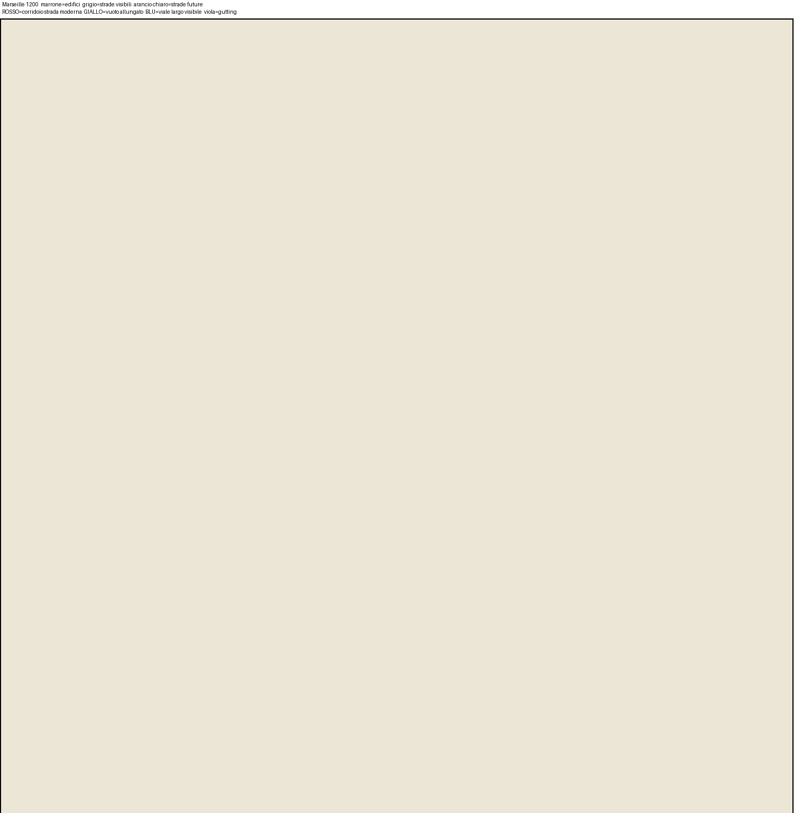
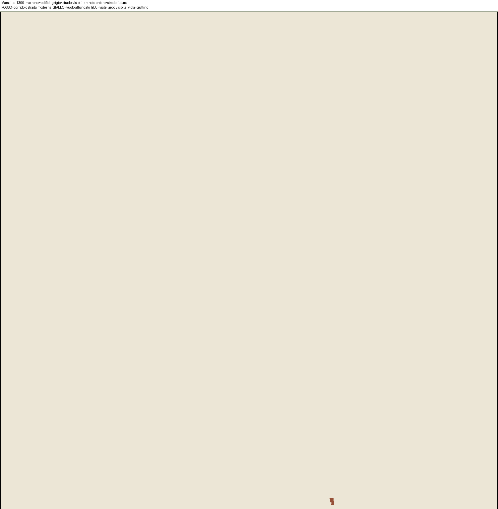
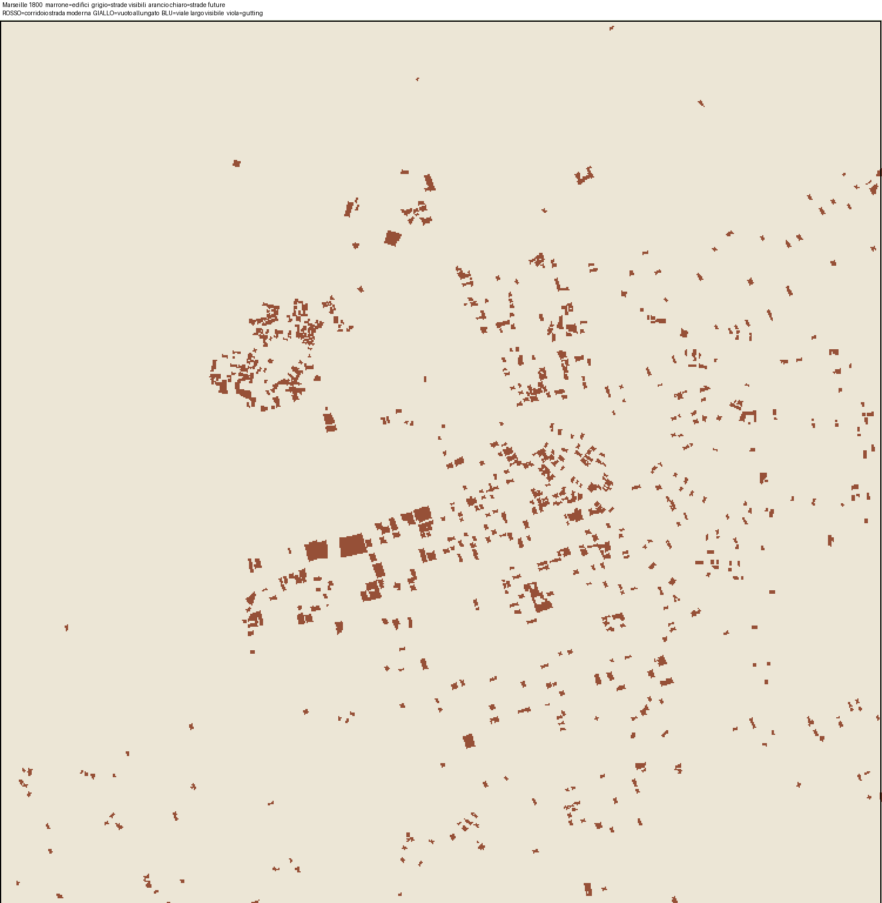
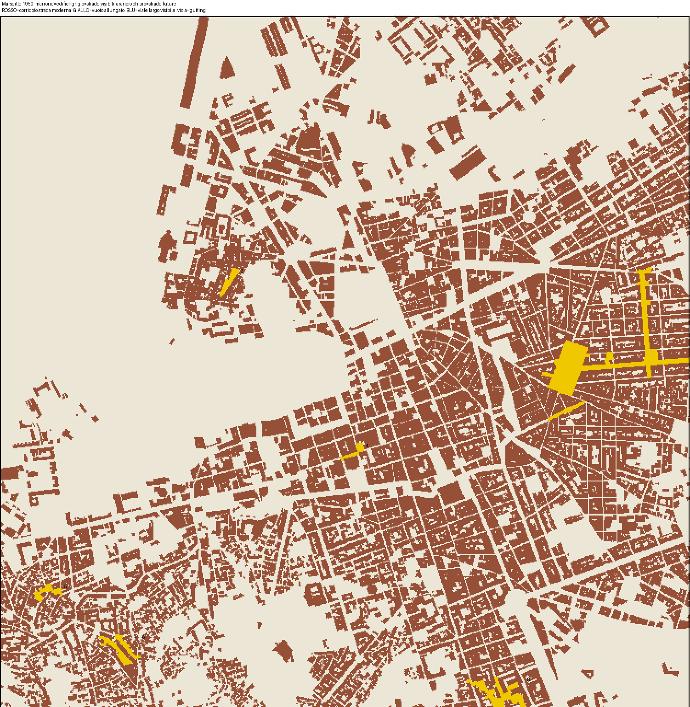

# QA marseille

Generato da `python -m kit.qa` il 2026-11-16 08:03. Esito complessivo: **FAIL**

| Sezione | Esito |
|---|---|
| a) Story e fonti | PASS |
| b) DATA | FAIL |
| c) Densita' storica | WARN |
| d) Corridoi vuoti | WARN |
| e) Costo e schedule | FAIL |

## a) Story e fonti

- **PASS** chiavi city
- **PASS** 0 fonti
- **PASS** date con fonte

## b) DATA

- **PASS** cartella DATA
  - data_marseille
- **PASS** buildings.json
  - 154128 voci
- **FAIL** roads.json mancante
  - roads.json e' obbligatorio (Siviglia 26 ott)
- **FAIL** hist.json mancante
  - lancia python -m kit build
- **WARN** land.json mancante
- **WARN** landmarks.json mancante
  - lancia python -m kit build
- **WARN** dem.npz
  - manca: citta' piatta
- **PASS** anni edifici (154128)
  - senza anno 0, anno 0 (segnaposto): 0, dopo 2026: 0, prima di 1200 (compaiono all'inizio): 1, d<=y: 0, ring<3: 0

## c) Densita' storica

- **WARN** nessuna zona storica nella story
  - impossibile verificare la citta' piena all'anno di partenza

## d) Corridoi vuoti

- **WARN** nessuna zona: centro storico = 1,5 km attorno all'origine
- **PASS** 1200: nessun corridoio vuoto
  - corridoi_1200.png
- **PASS** 1300: nessun corridoio vuoto
  - corridoi_1300.png
- **PASS** 1800: nessun corridoio vuoto
  - corridoi_1800.png
- **WARN** 1900: 4 aree vuote allungate
  - #1 134x27 m a (43.29843,5.36830); #2 169x17 m a (43.29338,5.38642); #3 121x21 m a (43.29175,5.37489); #4 149x31 m a (43.28748,5.38129) — corridoi_1900.png
- **WARN** 1950: 8 aree vuote allungate
  - #1 659x77 m a (43.29649,5.38909); #2 136x25 m a (43.29843,5.36830); #3 169x16 m a (43.29338,5.38642); #4 121x21 m a (43.29175,5.37489); #5 124x31 m a (43.28622,5.35858); #6 145x20 m a (43.28410,5.36285) — corridoi_1950.png

## e) Costo e schedule

- **FAIL** city_marseille.json mancante
  - python -m kit.city_json <slug>
- **FAIL** schedule_marseille.json mancante
  - lancia la regia (python -m kit build)

## Immagini

