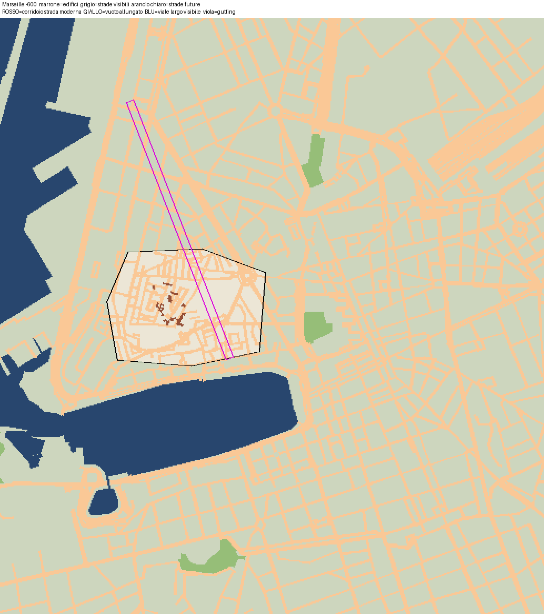
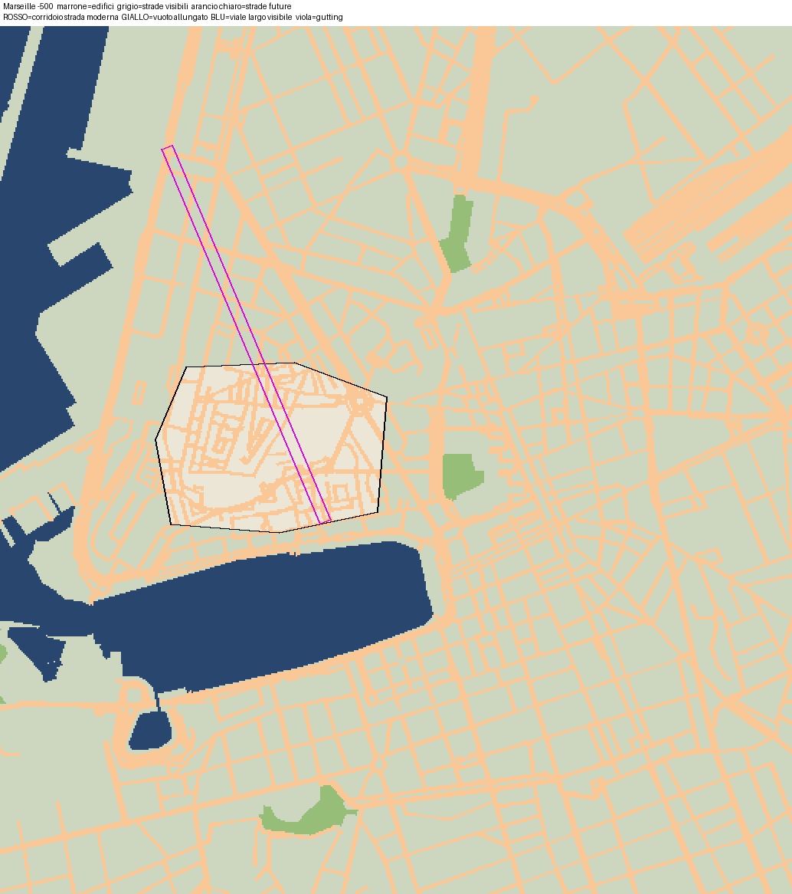

# QA marseille

Generato da `python -m kit.qa` il 2026-11-16 09:36. Esito complessivo: **WARN**

| Sezione | Esito |
|---|---|
| a) Story e fonti | PASS |
| b) DATA | PASS |
| c) Densita' storica | PASS |
| d) Corridoi vuoti | WARN |
| e) Costo e schedule | WARN |

## a) Story e fonti

- **PASS** chiavi city
- **PASS** 32 fonti
- **PASS** date con fonte

## b) DATA

- **PASS** cartella DATA
  - data_marseille
- **PASS** buildings.json
  - 154128 voci
- **PASS** roads.json
  - 177736 voci
- **PASS** hist.json
  - 9120 voci
- **PASS** land.json
  - 134 voci
- **PASS** landmarks.json
  - 713 voci
- **PASS** dem.npz
- **PASS** anni edifici (154128)
  - senza anno 0, anno 0 (segnaposto): 0, dopo 2026: 0, prima di -600 (compaiono all'inizio): 0, d<=y: 0, ring<3: 0
- **PASS** hist (9120 predecessori)
  - senza y/d 0, d<y 0, nati dopo 2026: 0
- **PASS** anni strade (177736 nastri)
  - senza anno 0, dopo 2026: 0; visibili all'inizio 0, nel 1800 7735

## c) Densita' storica

- **PASS** Archaic Massalia (Saint-Laurent and Moulins hills) nel 1500
  - 1284 edifici vivi (57/ha, copertura 48%) contro 881 (39/ha, copertura 51%) nel 2026: rapporto 1.46
- **PASS** Archaic Massalia (Saint-Laurent and Moulins hills) nel 1800
  - 1300 edifici vivi (57/ha, copertura 50%) contro 881 (39/ha, copertura 51%) nel 2026: rapporto 1.48
- **PASS** Hellenistic Massalia (Saint-Laurent, Moulins and Carmes hills) nel 1500
  - 2594 edifici vivi (46/ha, copertura 44%) contro 1289 (23/ha, copertura 52%) nel 2026: rapporto 2.01
- **PASS** Hellenistic Massalia (Saint-Laurent, Moulins and Carmes hills) nel 1800
  - 2551 edifici vivi (45/ha, copertura 46%) contro 1289 (23/ha, copertura 52%) nel 2026: rapporto 1.98
- **PASS** Saint-Victor and the south shore nel 1500
  - 1181 edifici vivi (34/ha, copertura 40%) contro 527 (15/ha, copertura 50%) nel 2026: rapporto 2.24
- **PASS** Saint-Victor and the south shore nel 1800
  - 1018 edifici vivi (29/ha, copertura 47%) contro 527 (15/ha, copertura 50%) nel 2026: rapporto 1.93
- **PASS** Medieval Marseille (Ville haute and Ville basse) nel 1500
  - 3487 edifici vivi (40/ha, copertura 39%) contro 1748 (20/ha, copertura 45%) nel 2026: rapporto 1.99
- **PASS** Medieval Marseille (Ville haute and Ville basse) nel 1800
  - 3402 edifici vivi (39/ha, copertura 40%) contro 1748 (20/ha, copertura 45%) nel 2026: rapporto 1.95
- **PASS** Louis XIV extension (1666-1700) nel 1800
  - 3466 edifici vivi (43/ha, copertura 53%) contro 2679 (33/ha, copertura 56%) nel 2026: rapporto 1.29

## d) Corridoi vuoti

- **PASS** -600: nessun corridoio vuoto
  - corridoi_-600.png
- **PASS** -500: nessun corridoio vuoto
  - corridoi_-500.png
- **WARN** 1800: 6 aree vuote allungate
  - #1 217x49 m a (43.29936,5.36285); #2 133x16 m a (43.29860,5.37660); #3 206x24 m a (43.29820,5.38235); #4 329x18 m a (43.29603,5.37157); #5 179x39 m a (43.29518,5.37396); #6 168x29 m a (43.28969,5.36744) — corridoi_1800.png
- **WARN** 1800: 3 viali larghi gia' visibili (se aperti sventrando: gutting)
  - #7 1996x71 m a (43.29722,5.37314); #8 369x18 m a (43.28944,5.36347); #9 340x23 m a (43.29784,5.37453)
- **WARN** 1900: 8 aree vuote allungate
  - #1 290x64 m a (43.29970,5.36475); #2 217x49 m a (43.29936,5.36285); #3 133x16 m a (43.29860,5.37660); #4 206x24 m a (43.29820,5.38235); #5 329x18 m a (43.29603,5.37157); #6 138x26 m a (43.29577,5.38309) — corridoi_1900.png
- **WARN** 1900: 4 viali larghi gia' visibili (se aperti sventrando: gutting)
  - #9 1971x75 m a (43.29720,5.37322); #10 588x74 m a (43.30428,5.36665); #11 372x18 m a (43.28944,5.36347); #12 344x24 m a (43.29784,5.37458)
- **WARN** 1950: 9 aree vuote allungate
  - #1 290x64 m a (43.29970,5.36475); #2 217x49 m a (43.29936,5.36285); #3 133x16 m a (43.29860,5.37660); #4 206x24 m a (43.29820,5.38235); #5 222x53 m a (43.29670,5.36404); #6 329x18 m a (43.29603,5.37157) — corridoi_1950.png

## e) Costo e schedule

- **PASS** costo dei cambi (6 s)
  - oggetti citta' 1265, cambi in tutto il video 34337, max in un fotogramma 420 (~5 s), costo dei soli cambi ~0.11 h (budget 1.0 h)
- **PASS** drone: velocita' massima
  - 152 m/s (limite 250), mediana 6
- **PASS** drone: accelerazione massima
  - 81 m/s2 (limite 120), 99% 37
- **PASS** drone: jerk massimo
  - 110 m/s3 (limite 200), 99% 27
- **PASS** drone: distanza minima da terreno e tetti
  - 464 m (soglia 24); dal solo terreno 499 m
- **PASS** drone: discontinuita' (target 0, tagli dichiarati: 0)
  - 0 salti
- **PASS** drone: soste tolte per tempo
  - 0 tolte, 15 tenute, 0 solo sorvolate; hover 85 s, volo 543 s; 
- **PASS** drone: hover quasi fermo
  - v max in hover 11.3 m/s (soglia 12; esclusi 30% o 1,5 s a ogni estremo)
- **PASS** drone: voli con gli anni quasi fermi
  - nessun volo >= 12 s sotto 0,4 anni/s (fuori da apertura e finale)  [uniscili: trasforma una delle due soste vicine in cartello]
- **PASS** drone: monumenti visibili durante il loro hover
  - ogni monumento bersaglio ha il corpo costruito a meta' hover  [Confluences: il corpo compariva a fine hover]
- **PASS** drone: distanza della camera
  - mediana 1755 m equivalenti a 35 mm (obiettivo 32 mm); riferimenti: Copenaghen 1397, Parigi 1427, Madrid 2538, Lione 930 (giudicata troppo vicina); soglia 1200
- **PASS** drone: esattezza anni
  - soste: y0 e y1 esatti sulla finestra di hover; cartelli fuori hover esatti; cartelli durante un hover e voli: anni flessibili (il contatore scorre fra le voci)
- **WARN** drone: grafico non fatto
  - No module named 'matplotlib'
- **WARN** ritmo: nessun vuoto > 15 s senza stimolo nuovo
  - vuoto massimo 18.6 s (375-394 s); 3 oltre 15 s: 375-394, 401-418, 533-548
- **PASS** ritmo: anni/s per minuto
  - 0:00 35.82 | 1:00 14.37 | 2:00 11.40 | 3:00  4.96 | 4:00  2.39 | 5:00  0.58 | 6:00  0.60 | 7:00  0.30 | 8:00  0.57 | 9:00  0.48 | 10:00  0.18
- **PASS** 15 soste ben formate
- **PASS** soste ordinate e non sovrapposte
- **PASS** didascalie "Titolo (data)"
- **PASS** soste e cartelli sugli anni della story (0,01)
- **PASS** evento forte entro 45 s
  - primo a 15.7 s
- **PASS** notte
  - night_t=644.106640539748, schedule_marseille_night.json ok

## Immagini

