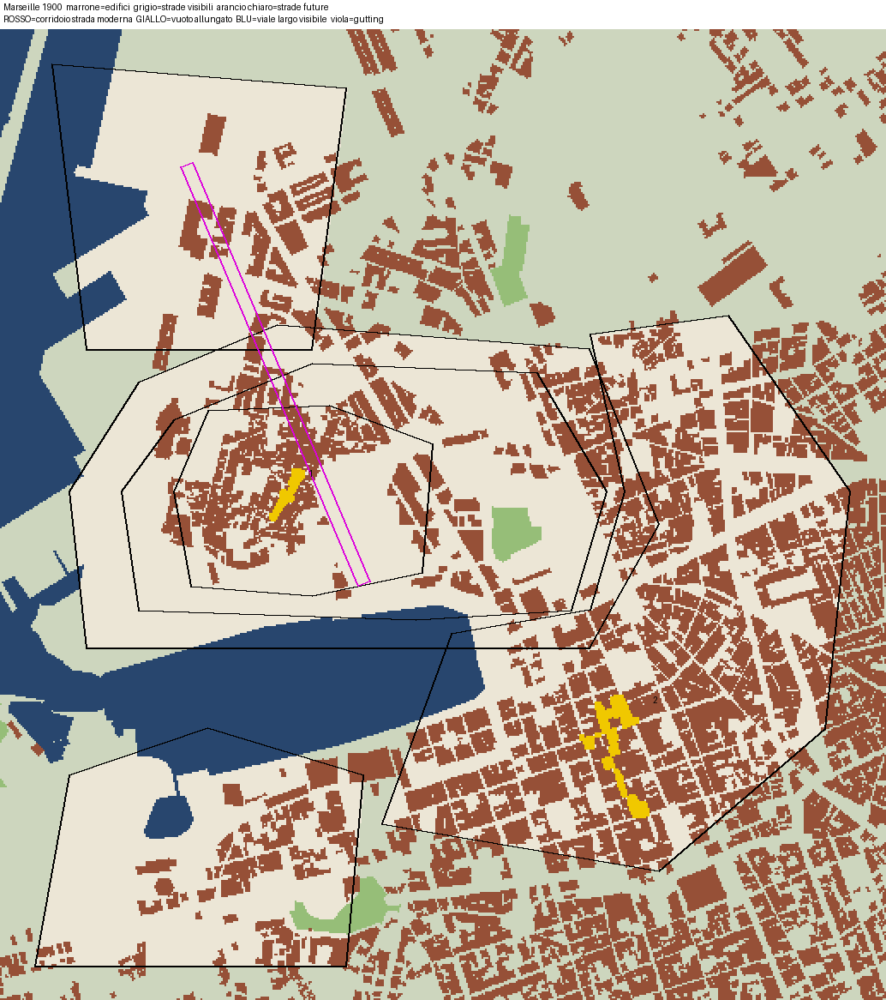

# QA marseille

Generato da `python -m kit.qa` il 2026-11-16 08:28. Esito complessivo: **FAIL**

| Sezione | Esito |
|---|---|
| a) Story e fonti | PASS |
| b) DATA | FAIL |
| c) Densita' storica | FAIL |
| d) Corridoi vuoti | FAIL |
| e) Costo e schedule | FAIL |

## a) Story e fonti

- **PASS** chiavi city
- **PASS** 30 fonti
- **PASS** date con fonte

## b) DATA

- **PASS** cartella DATA
  - data_marseille
- **PASS** buildings.json
  - 154128 voci
- **FAIL** roads.json mancante
  - roads.json e' obbligatorio (Siviglia 26 ott)
- **FAIL** hist.json mancante
  - lancia python -m kit build
- **PASS** land.json
  - 135 voci
- **FAIL** landmarks.json mancante
  - lancia python -m kit build
- **PASS** dem.npz
- **PASS** anni edifici (154128)
  - senza anno 0, anno 0 (segnaposto): 0, dopo 2026: 0, prima di -600 (compaiono all'inizio): 0, d<=y: 0, ring<3: 0

## c) Densita' storica

- **FAIL** Archaic Massalia (Saint-Laurent and Moulins hills) nel 1500
  - 3 edifici vivi (0/ha, copertura 0%) contro 842 (37/ha, copertura 49%) nel 2026: rapporto 0.00
- **FAIL** Archaic Massalia (Saint-Laurent and Moulins hills) nel 1800
  - 170 edifici vivi (7/ha, copertura 6%) contro 842 (37/ha, copertura 49%) nel 2026: rapporto 0.20
- **FAIL** Hellenistic Massalia (Saint-Laurent, Moulins and Carmes hills) nel 1500
  - 3 edifici vivi (0/ha, copertura 0%) contro 1189 (21/ha, copertura 46%) nel 2026: rapporto 0.00
- **FAIL** Hellenistic Massalia (Saint-Laurent, Moulins and Carmes hills) nel 1800
  - 196 edifici vivi (3/ha, copertura 3%) contro 1189 (21/ha, copertura 46%) nel 2026: rapporto 0.16
- **FAIL** Saint-Victor and the south shore nel 1500
  - 0 edifici vivi (0/ha, copertura 0%) contro 432 (12/ha, copertura 37%) nel 2026: rapporto 0.00
- **FAIL** Saint-Victor and the south shore nel 1800
  - 28 edifici vivi (1/ha, copertura 3%) contro 432 (12/ha, copertura 37%) nel 2026: rapporto 0.06
- **FAIL** Medieval Marseille (Ville haute and Ville basse) nel 1500
  - 3 edifici vivi (0/ha, copertura 0%) contro 1604 (18/ha, copertura 40%) nel 2026: rapporto 0.00
- **FAIL** Medieval Marseille (Ville haute and Ville basse) nel 1800
  - 232 edifici vivi (3/ha, copertura 2%) contro 1604 (18/ha, copertura 40%) nel 2026: rapporto 0.14
- **FAIL** Louis XIV extension (1666-1700) nel 1800
  - 218 edifici vivi (3/ha, copertura 5%) contro 2679 (33/ha, copertura 56%) nel 2026: rapporto 0.08

## d) Corridoi vuoti

- **PASS** -600: nessun corridoio vuoto
  - corridoi_-600.png
- **FAIL** -500: gutting non riempiti
  - Rue Imperiale (Rue de la Republique): 100% vuoto (case predecessore mancanti)
- **FAIL** 1800: gutting non riempiti
  - Rue Imperiale (Rue de la Republique): 88% vuoto (case predecessore mancanti)
- **WARN** 1900: 2 aree vuote allungate
  - #1 134x26 m a (43.29843,5.36828); #2 303x39 m a (43.29291,5.37771) — corridoi_1900.png
- **WARN** 1950: 1 aree vuote allungate
  - #1 136x25 m a (43.29843,5.36828) — corridoi_1950.png

## e) Costo e schedule

- **FAIL** city_marseille.json mancante
  - python -m kit.city_json <slug>
- **FAIL** schedule_marseille.json mancante
  - lancia la regia (python -m kit build)

## Immagini

