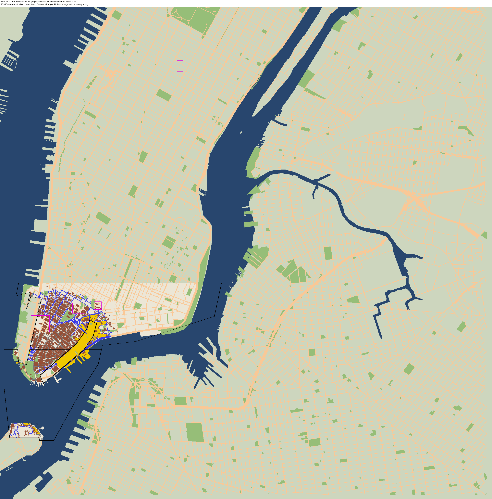
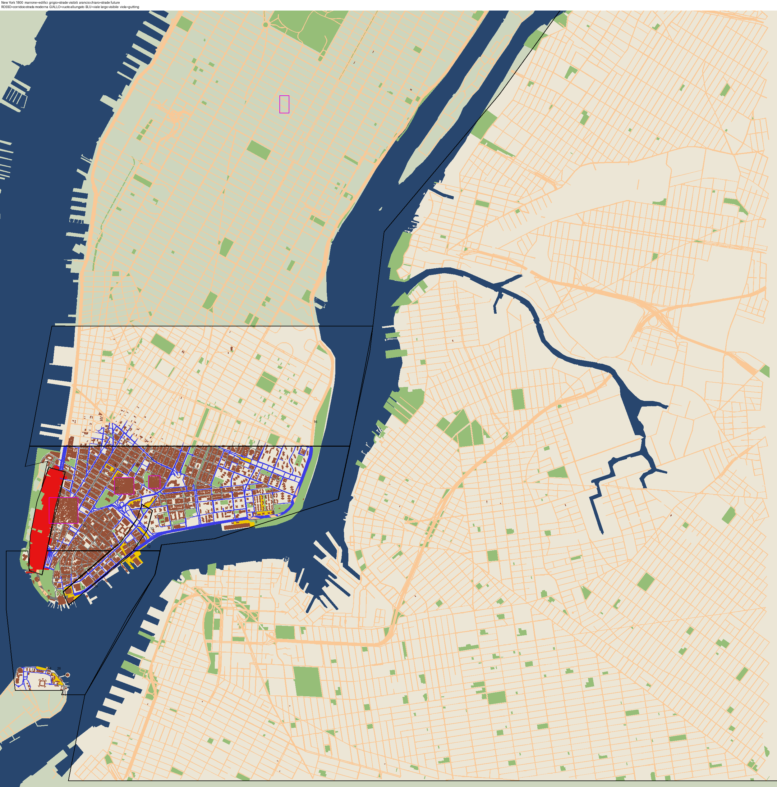
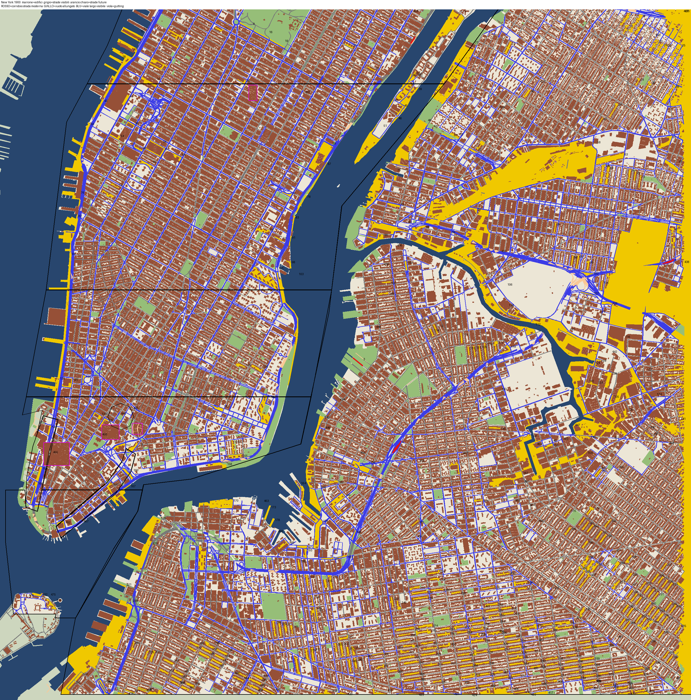
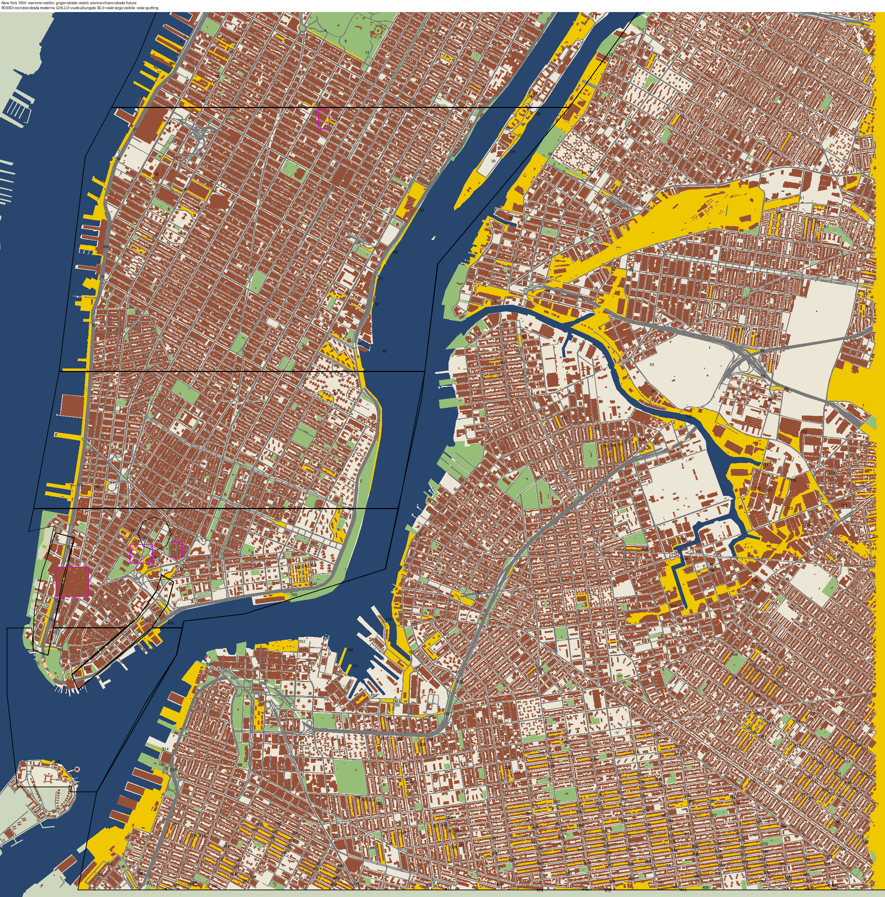

# QA nyc

Generato da `python -m kit.qa` il 2026-11-19 16:15. Esito complessivo: **WARN**

| Sezione | Esito |
|---|---|
| a) Story e fonti | WARN |
| b) DATA | PASS |
| c) Densita' storica | PASS |
| d) Corridoi vuoti | WARN |
| e) Costo e schedule | WARN |

## a) Story e fonti

- **PASS** chiavi city
- **PASS** 75 fonti
- **PASS** date con fonte
- **WARN** date fuori dall'intervallo del video
  - history.water[0] East-shore infill (Pearl Street to South Street): 99999; history.water[1] West-shore infill (Greenwich Street to West Street): 99999; history.water[2] Collect Pond: 99999; history.water[3] Battery Park City: 99999; history.water[4] Governors Island south fill: 99999; history.water[5] Ellis Island fill (islands 2 and 3): 99999

## b) DATA

- **PASS** cartella DATA
  - data_nyc
- **PASS** buildings.json
  - 145927 voci
- **PASS** roads.json
  - 117786 voci
- **PASS** hist.json
  - 305144 voci
- **PASS** land.json
  - 320 voci
- **PASS** landmarks.json
  - 628 voci
- **PASS** dem.npz
- **PASS** anni edifici (145927)
  - senza anno 0, anno 0 (segnaposto): 0, dopo 2026: 0, prima di 1609 (compaiono all'inizio): 0, d<=y: 0, ring<3: 0
- **PASS** hist (305144 predecessori)
  - senza y/d 0, d<y 0, nati dopo 2026: 0
- **PASS** anni strade (117786 nastri)
  - senza anno 0, dopo 2026: 0; visibili all'inizio 0, nel 1800 6597

## c) Densita' storica

- **PASS** East-shore infill (Pearl Street to South Street) nel 1800
  - 763 edifici vivi (26/ha, copertura 31%) contro 151 (5/ha, copertura 34%) nel 2026: rapporto 5.05
- **PASS** New Amsterdam (Battery to Wall Street) nel 1800
  - 1379 edifici vivi (6/ha, copertura 6%) contro 214 (1/ha, copertura 7%) nel 2026: rapporto 6.44
- **PASS** Colonial town (Wall Street to Canal Street) nel 1800
  - 9753 edifici vivi (23/ha, copertura 28%) contro 2683 (6/ha, copertura 30%) nel 2026: rapporto 3.64

## d) Corridoi vuoti

- **WARN** centro storico molto grande: raster limitato a 10 km
- **WARN** 1709: 6 aree vuote allungate
  - #1 131x23 m a (40.71640,-74.00340); #2 1251x252 m a (40.70821,-74.00281); #3 188x25 m a (40.71248,-74.00198); #4 148x18 m a (40.70620,-74.01533); #5 136x33 m a (40.69308,-74.01614); #6 180x36 m a (40.69185,-74.01365) — corridoi_1709.png
- **WARN** 1709: 9 viali larghi gia' visibili (se aperti sventrando: gutting)
  - #7 1152x109 m a (40.71105,-74.00255); #8 833x63 m a (40.71550,-74.00758); #9 643x23 m a (40.70437,-74.00753); #10 387x19 m a (40.69223,-74.01588); #11 301x56 m a (40.70596,-74.01462)
- **WARN** 1800: 1 corridoi accettati (FAIL -> WARN)
  - #0 1338x220 m a (40.71047,-74.01533) — West-shore landfill strip (Greenwich-West Street) drawn as modern land at 1800: the water-phase ring rises it from 1800 and the zone is born 1800-1830; verify by frame
- **WARN** 1800: 14 aree vuote allungate
  - #1 175x34 m a (40.71751,-73.98521); #2 140x27 m a (40.71651,-74.00580); #3 158x23 m a (40.71561,-74.00464); #4 192x23 m a (40.71239,-73.98244); #5 161x40 m a (40.71237,-73.99966); #6 188x25 m a (40.71248,-74.00198) — corridoi_1800.png
- **WARN** 1800: 12 viali larghi gia' visibili (se aperti sventrando: gutting)
  - #15 3113x174 m a (40.71248,-73.99401); #16 387x19 m a (40.69223,-74.01588); #17 361x21 m a (40.71608,-74.00366); #18 361x29 m a (40.70864,-74.01185); #19 327x50 m a (40.71765,-74.01306)
- **WARN** 1900: 4 corridoi accettati (FAIL -> WARN)
  - #0 123x20 m a (40.76572,-73.95160) — 1900 waterfront sliver (East River / Roosevelt Island channel), not a street; #0 163x26 m a (40.73672,-73.90777) — 1900 Newtown Creek bank sliver, not a street; #0 188x18 m a (40.72357,-73.96104) — 1900 Greenpoint waterfront sliver, not a street; #0 193x30 m a (40.71242,-73.95435) — 1900 Williamsburg waterfront sliver, not a street
- **WARN** 1900: 420 aree vuote allungate
  - #1 555x129 m a (40.76719,-73.94581); #2 8147x315 m a (40.72485,-73.91137); #3 211x30 m a (40.76849,-73.91515); #4 326x34 m a (40.76790,-73.91332); #5 216x15 m a (40.76755,-73.98021); #6 165x36 m a (40.76715,-73.91285) — corridoi_1900.png
- **WARN** 1900: 67 viali larghi gia' visibili (se aperti sventrando: gutting)
  - #421 7217x393 m a (40.73632,-73.98376); #422 6339x214 m a (40.70913,-73.97152); #423 4706x325 m a (40.74248,-73.93317); #424 1966x148 m a (40.70254,-73.94297); #425 1603x22 m a (40.69431,-73.95457)
- **WARN** 1950: 415 aree vuote allungate
  - #1 555x129 m a (40.76719,-73.94581); #2 9421x165 m a (40.72485,-73.90775); #3 143x19 m a (40.76847,-73.90794); #4 216x15 m a (40.76755,-73.98021); #5 323x27 m a (40.76667,-73.99963); #6 122x22 m a (40.76714,-73.98478) — corridoi_1950.png

## e) Costo e schedule

- **PASS** costo dei cambi (11 s)
  - oggetti citta' 2186, cambi in tutto il video 79085, max in un fotogramma 780 (~9 s), costo dei soli cambi ~0.26 h (budget 1.0 h)
- **PASS** drone: velocita' massima
  - 138 m/s (limite 250), mediana 14
- **PASS** drone: accelerazione massima
  - 114 m/s2 (limite 120), 99% 56
- **PASS** drone: jerk massimo
  - 104 m/s3 (limite 200), 99% 55
- **PASS** drone: distanza minima da terreno e tetti
  - 469 m (soglia 48); dal solo terreno 479 m
- **PASS** drone: discontinuita' (target 0, tagli dichiarati: 0)
  - 0 salti
- **PASS** drone: soste tolte per tempo
  - 0 tolte, 15 tenute, 0 solo sorvolate; hover 98 s, volo 427 s; 
- **PASS** drone: hover quasi fermo
  - v max in hover 4.0 m/s (soglia 12; esclusi 30% o 1,5 s a ogni estremo)
- **PASS** drone: voli con gli anni quasi fermi
  - nessun volo >= 12 s sotto 0,4 anni/s (fuori da apertura e finale)  [uniscili: trasforma una delle due soste vicine in cartello]
- **PASS** drone: monumenti visibili durante il loro hover
  - ogni monumento bersaglio ha il corpo costruito a meta' hover  [Confluences: il corpo compariva a fine hover]
- **PASS** drone: distanza della camera
  - mediana 1438 m equivalenti a 35 mm (obiettivo 32 mm); riferimenti: Copenaghen 1397, Parigi 1427, Madrid 2538, Lione 930 (giudicata troppo vicina); soglia 1200
- **PASS** drone: esattezza anni
  - soste: y0 e y1 esatti sulla finestra di hover; cartelli fuori hover esatti; cartelli durante un hover e voli: anni flessibili (il contatore scorre fra le voci)
- **WARN** drone: grafico non fatto
  - No module named 'matplotlib'
- **WARN** ritmo: nessun vuoto > 15 s senza stimolo nuovo
  - vuoto massimo 18.2 s (437-455 s); 1 oltre 15 s: 437-455
- **PASS** ritmo: anni/s per minuto
  - 0:00  6.21 | 1:00  2.05 | 2:00  0.82 | 3:00  0.61 | 4:00  0.61 | 5:00  0.41 | 6:00  0.68 | 7:00  0.82 | 8:00  0.22 | 9:00  0.00
- **PASS** 15 soste ben formate
- **PASS** soste ordinate e non sovrapposte
- **PASS** didascalie "Titolo (data)"
- **PASS** soste e cartelli sugli anni della story (0,01)
- **PASS** evento forte entro 45 s
  - primo a 15.7 s
- **PASS** notte
  - night_t=540.2748639736368, schedule_nyc_night.json ok

## Immagini

