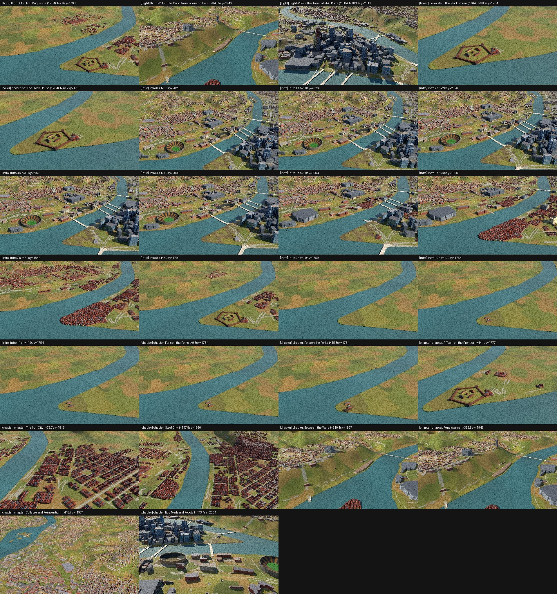
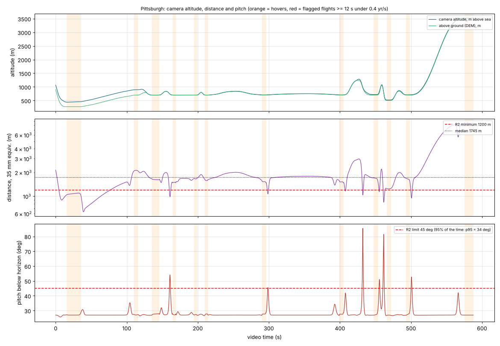
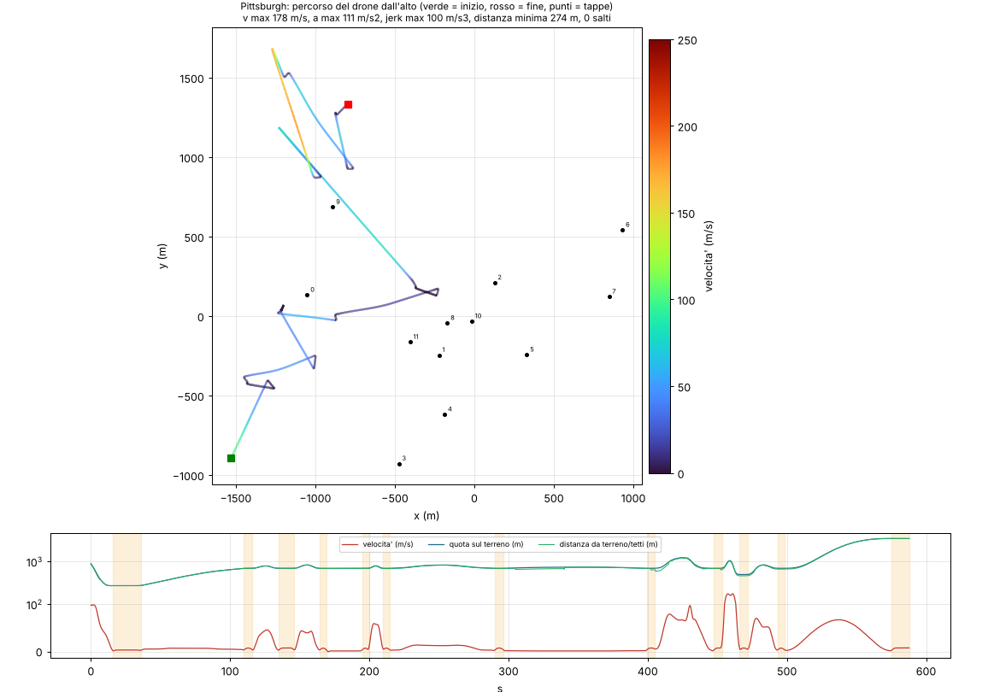
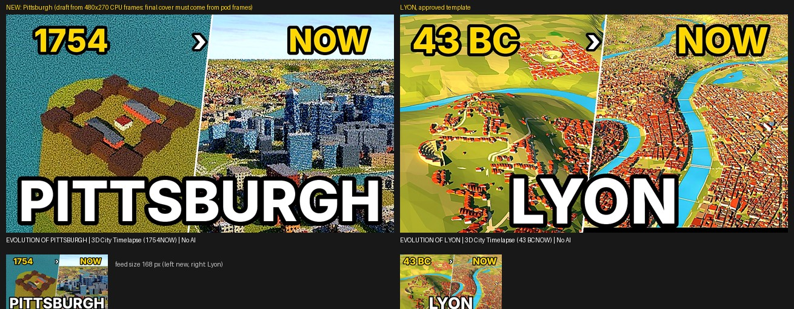

# GO dossier: Pittsburgh (pittsburgh)

Generated by `python -m kit gate pittsburgh` on 2026-11-17 15:40 in 3301 s. **Overall: WARN, 0 FAIL** (matplotlib FAIL resolved: plots.png and drone_path.png regenerated with pghenv python on the same schedule; contact sheet frames predate the `look.water_color` merge, see water crops) / kit qa alone: **WARN**. No pod before a written GO (R3).

## Verdict (R2)

- **PASS** R2 camera distance: median 1745 m (35 mm equiv.), minimum 1200; refs: Copenhagen 1397, Paris 1427
- **PASS** R2 look angle: p95 34 deg (limit 45), 98.5% of keys under it, max 85 deg
- **PASS** R2 frozen-counter flights: 0 flight(s) >= 12 s under 0.4 yr/s
- **PASS** plots: plots.png (median 1745 m, p95 pitch 34 deg) regenerated with /home/user/pghenv/bin/python
- **PASS** contact sheet: 26/26 real local frames: contact_sheet.jpg
- **WARN** packaging draft: the left frame shows year 2026, the label says 1754: the frame must show the first year (Lyon's mistake); city json has no cover.shots: frames are a fallback (first hover / last flight second), define cover.shots
- **WARN** banner: branch claude/pittsburgh-int has no upstream: not pushed
- **WARN** banner: 1 uncommitted changes that the pod will not see (e.g. M cities/pittsburgh/gate/contact_sheet.jpg)

## 1. Contact sheet (real local CPU frames, 480x270)



Frames: flight:flight #1 -> Fort Duquesne and Fort Pitt (1@7.9s; flight:flight #8 -> The Civic Arena opens on the c@347.8s; flight:flight #11 -> The Tower at PNC Plaza (2015)@482.5s; hover:hover start: Fort Duquesne and Fort Pitt (1755-@16.2s; hover:hover end: Fort Duquesne and Fort Pitt (1755-@35.6s; intro:intro 0 s@0.0s; intro:intro 1 s@1.0s; intro:intro 2 s@2.0s; intro:intro 3 s@3.0s; intro:intro 4 s@4.0s; intro:intro 5 s@5.0s; intro:intro 6 s@6.0s; intro:intro 7 s@7.0s; intro:intro 8 s@8.0s; intro:intro 9 s@9.0s; intro:intro 10 s@10.0s; intro:intro 11 s@11.0s; chapter:chapter: Forts on the Forks@9.5s; chapter:chapter: Forts on the Forks@15.8s; chapter:chapter: A Town on the Frontier@36.6s; chapter:chapter: The Iron City@71.0s; chapter:chapter: Steel City@147.1s; chapter:chapter: Between the Wars@309.4s; chapter:chapter: Renaissance@359.0s; chapter:chapter: Collapse and Reinvention@418.0s; chapter:chapter: Eds, Meds and Robots@472.6s

## 2. Camera altitude, distance, pitch





Median distance 1745 m (>= 1200); pitch p95 34 deg (< 45); max pitch 85 deg.

## 3. Flight table

| # | start s | end s | dur s | years/s | median dist m | max alt m | max pitch deg | to | flag |
|---|---|---|---|---|---|---|---|---|---|
| 1 | 0.0 | 15.7 | 15.7 | 17.23 | 1015 | 1069 | 27 | Fort Duquesne and Fort Pitt (1755- | (opening) |
| 2 | 36.1 | 110.0 | 73.9 | 1.12 | 1147 | 893 | 35 | The Great Fire (April 1845) |  |
| 3 | 116.0 | 135.0 | 19.0 | 0.64 | 1988 | 914 | 27 | 939 factories (1857) |  |
| 4 | 146.2 | 164.4 | 18.2 | 0.70 | 1630 | 839 | 54 | The Monongahela Incline (1870) |  |
| 5 | 169.4 | 194.8 | 25.4 | 0.48 | 1674 | 700 | 29 | The Smithfield Street Bridge (1883 |  |
| 6 | 199.8 | 209.6 | 9.9 | 0.45 | 1796 | 801 | 28 | The Allegheny County Courthouse (1 |  |
| 7 | 214.6 | 290.2 | 75.6 | 0.41 | 1849 | 842 | 27 | The Hill District, a center of Bla |  |
| 8 | 296.2 | 399.3 | 103.1 | 0.40 | 1774 | 752 | 46 | The Civic Arena opens on the clear |  |
| 9 | 405.3 | 447.5 | 42.2 | 0.52 | 1880 | 1284 | 85 | PPG Place and the second Renaissan |  |
| 10 | 453.8 | 465.9 | 12.1 | 1.26 | 1265 | 1079 | 81 | Three Rivers Stadium is imploded;  |  |
| 11 | 471.9 | 493.2 | 21.3 | 0.66 | 1777 | 864 | 27 | The Tower at PNC Plaza (2015) |  |
| 12 | 498.2 | 575.3 | 77.1 | 0.13 | 5058 | 3520 | 53 | finale | (finale) |

## 4. kit qa

Result: **WARN** (full report: qa_REPORT.md)

- **WARN** d) 1800: 2 viali larghi gia' visibili (se aperti sventrando: gutting): #1 885x144 m a (40.45166,-80.00373); #2 846x112 m a (40.44093,-80.00479)
- **WARN** d) 1854: 2 corridoi accettati (FAIL -> WARN): #0 475x31 m a (40.45604,-79.99801) — modern expressway/rail strip along the Allegheny River bank, outside the 1854 town: open riverbank in 1854; accepted; #0 856x74 m a (40.43406,-79.99067) — modern riverfront strip (Carson Street, Monongahela bank) between the South Side zone and the river: open bank in 1854; accepted
- **WARN** d) 1854: 60 aree vuote allungate: #1 278x55 m a (40.47285,-80.01102); #2 226x45 m a (40.47303,-80.00989); #3 126x24 m a (40.47332,-80.00824); #4 289x38 m a (40.47209,-80.01133); #5 745x65 m a (40.47028,-80.00517); #6 143x30 m a (40.47102,-80.01329) — corridoi_1854.png
- **WARN** d) 1854: 33 viali larghi gia' visibili (se aperti sventrando: gutting): #61 2183x174 m a (40.45584,-80.00491); #62 1775x65 m a (40.46330,-80.02230); #63 1034x59 m a (40.42867,-79.99523); #64 1008x77 m a (40.46947,-80.01161); #65 907x38 m a (40.44430,-80.00283)
- **WARN** d) 1900: 99 aree vuote allungate: #1 130x25 m a (40.47462,-80.02731); #2 277x49 m a (40.47285,-80.01097); #3 193x38 m a (40.47308,-80.00989); #4 126x24 m a (40.47332,-80.00824); #5 244x38 m a (40.47187,-80.01130); #6 555x64 m a (40.46957,-80.00495) — corridoi_1900.png
- **WARN** d) 1900: 40 viali larghi gia' visibili (se aperti sventrando: gutting): #100 2269x55 m a (40.45014,-79.98132); #101 2249x205 m a (40.45584,-80.00491); #102 1995x57 m a (40.46476,-80.02230); #103 1365x51 m a (40.42973,-79.99898); #104 1019x71 m a (40.46947,-80.01161)
- **WARN** d) 1950: 100 aree vuote allungate: #1 130x25 m a (40.47462,-80.02731); #2 277x49 m a (40.47285,-80.01097); #3 193x38 m a (40.47308,-80.00989); #4 126x24 m a (40.47332,-80.00824); #5 244x38 m a (40.47187,-80.01130); #6 555x64 m a (40.46957,-80.00495) — corridoi_1950.png
- **WARN** e) drone: grafico non fatto: No module named 'matplotlib'

## 5. Expected pod banner (quote it in the GO message)

```
VERSIONE: 4a94358 Pittsburgh: regenerate qa REPORT after merges | schedule_pittsburgh: 588 s, lens 32.0
```

Branch `claude/pittsburgh-int`. The GO message must contain, in ONE message: GPU check (`cuInit` = 0), `git pull` + this banner to verify, the launch command, the live progress one-liner, covers, and the condition to switch off (R3).

- WARN branch claude/pittsburgh-int has no upstream: not pushed
- WARN 1 uncommitted changes that the pod will not see (e.g. M cities/pittsburgh/gate/contact_sheet.jpg)

## 6. Cost (measured basis only, R4)

- Measured basis (Lyon, 16/11/2026) [Certain]: 29 pod-s per video-s (4 h 37 min real render / 565 s = 29.4), +30 min scene build per process (145K building groups), pod about 0.5 EUR/h [Likely: over 5 EUR for about 10 h].
- This city: video 9 min 48 s (588 s), 1 process(es) (day), buildings 179,756.
- Estimate scaled from Lyon [Likely]: render 4 h 44 min + scene build 30 min 00 s = **5 h 14 min of pod, about 2.6 EUR**. Say it as an estimate.
- Over 100K buildings: no separate preview, go straight to `full`, check the first frames, re-render only a bad segment (R3).

## 7. Packaging (R14: series formula)

- Title: `EVOLUTION OF PITTSBURGH | 3D City Timelapse (1754–NOW) | No AI`
- Lyon title (approved): `EVOLUTION OF LYON | 3D City Timelapse (43 BC–NOW) | No AI`
- Thumbnail: `1754 > NOW`, city name `PITTSBURGH`, two full halves, no flag.
- First-year hover frame and NOW frame come from the city json `cover.shots`; the draft is built from 480x270 CPU frames, the final cover is rendered on the pod frames.


- WARN the left frame shows year 2026, the label says 1754: the frame must show the first year (Lyon's mistake)
- WARN city json has no cover.shots: frames are a fallback (first hover / last flight second), define cover.shots

