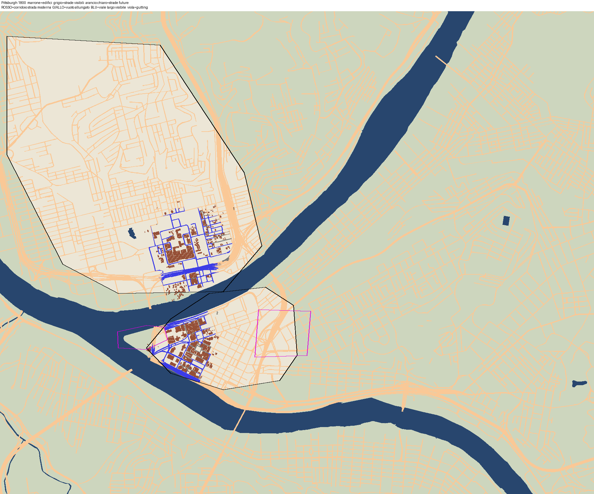
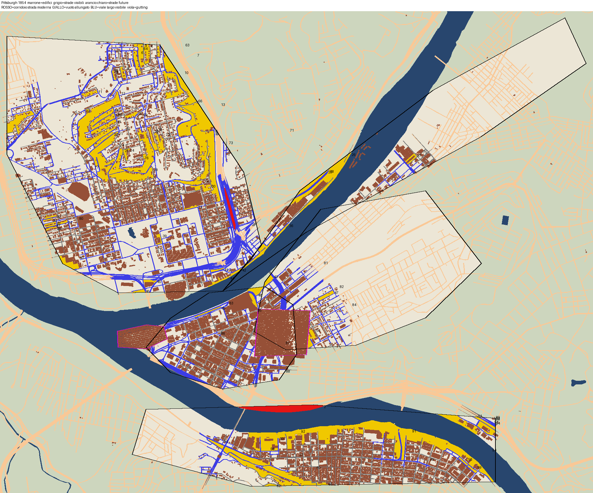
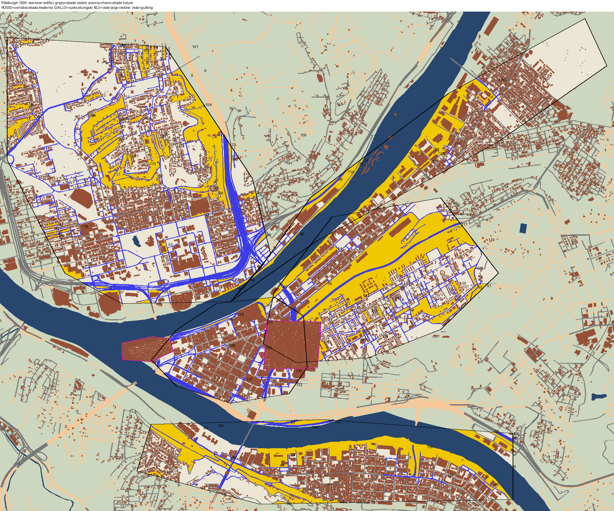
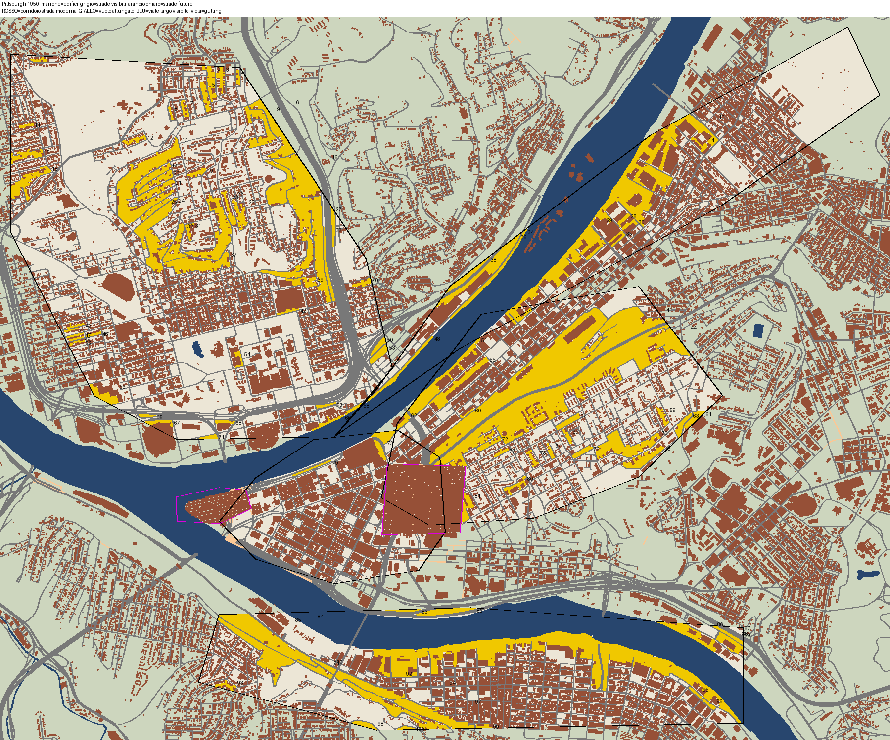

# QA pittsburgh

Generato da `python -m kit.qa` il 2026-11-17 09:21. Esito complessivo: **WARN**

| Sezione | Esito |
|---|---|
| a) Story e fonti | PASS |
| b) DATA | PASS |
| d) Corridoi vuoti | WARN |
| e) Costo e schedule | WARN |

## a) Story e fonti

- **PASS** chiavi city
- **PASS** 32 fonti
- **PASS** date con fonte

## b) DATA

- **PASS** cartella DATA
  - data_pittsburgh
- **PASS** buildings.json
  - 179756 voci
- **PASS** roads.json
  - 206419 voci
- **PASS** hist.json
  - 31768 voci
- **PASS** land.json
  - 54 voci
- **PASS** landmarks.json
  - 683 voci
- **PASS** dem.npz
- **PASS** anni edifici (179756)
  - senza anno 0, anno 0 (segnaposto): 0, dopo 2026: 0, prima di 1754 (compaiono all'inizio): 0, d<=y: 0, ring<3: 0
- **PASS** hist (31768 predecessori)
  - senza y/d 0, d<y 0, nati dopo 2026: 0
- **PASS** anni strade (206419 nastri)
  - senza anno 0, dopo 2026: 0; visibili all'inizio 0, nel 1800 1809

## d) Corridoi vuoti

- **WARN** 1800: 2 viali larghi gia' visibili (se aperti sventrando: gutting)
  - #1 885x144 m a (40.45166,-80.00373); #2 846x112 m a (40.44093,-80.00479)
- **PASS** 1800: nessun corridoio vuoto
  - corridoi_1800.png
- **WARN** 1854: 2 corridoi accettati (FAIL -> WARN)
  - #0 475x31 m a (40.45604,-79.99801) — modern expressway/rail strip along the Allegheny River bank, outside the 1854 town: open riverbank in 1854; accepted; #0 856x74 m a (40.43406,-79.99067) — modern riverfront strip (Carson Street, Monongahela bank) between the South Side zone and the river: open bank in 1854; accepted
- **WARN** 1854: 60 aree vuote allungate
  - #1 278x55 m a (40.47285,-80.01102); #2 226x45 m a (40.47303,-80.00989); #3 126x24 m a (40.47332,-80.00824); #4 289x38 m a (40.47209,-80.01133); #5 745x65 m a (40.47028,-80.00517); #6 143x30 m a (40.47102,-80.01329) — corridoi_1854.png
- **WARN** 1854: 33 viali larghi gia' visibili (se aperti sventrando: gutting)
  - #61 2183x174 m a (40.45584,-80.00491); #62 1775x65 m a (40.46330,-80.02230); #63 1034x59 m a (40.42867,-79.99523); #64 1008x77 m a (40.46947,-80.01161); #65 906x38 m a (40.44430,-80.00283)
- **WARN** 1900: 99 aree vuote allungate
  - #1 130x25 m a (40.47462,-80.02731); #2 277x49 m a (40.47285,-80.01097); #3 193x38 m a (40.47308,-80.00989); #4 126x24 m a (40.47332,-80.00824); #5 244x38 m a (40.47187,-80.01130); #6 555x64 m a (40.46957,-80.00495) — corridoi_1900.png
- **WARN** 1900: 40 viali larghi gia' visibili (se aperti sventrando: gutting)
  - #100 2269x55 m a (40.45014,-79.98132); #101 2249x205 m a (40.45584,-80.00491); #102 1995x57 m a (40.46476,-80.02230); #103 1365x51 m a (40.42973,-79.99898); #104 1019x71 m a (40.46947,-80.01161)
- **WARN** 1950: 100 aree vuote allungate
  - #1 130x25 m a (40.47462,-80.02731); #2 277x49 m a (40.47285,-80.01097); #3 193x38 m a (40.47308,-80.00989); #4 126x24 m a (40.47332,-80.00824); #5 244x38 m a (40.47187,-80.01130); #6 555x64 m a (40.46957,-80.00495) — corridoi_1950.png

## e) Costo e schedule

- **PASS** costo dei cambi (6 s)
  - oggetti citta' 2327, cambi in tutto il video 77473, max in un fotogramma 1015 (~12 s), costo dei soli cambi ~0.26 h (budget 1.0 h)
- **PASS** drone: velocita' massima
  - 135 m/s (limite 250), mediana 8
- **PASS** drone: accelerazione massima
  - 109 m/s2 (limite 120), 99% 51
- **PASS** drone: jerk massimo
  - 126 m/s3 (limite 200), 99% 48
- **PASS** drone: distanza minima da terreno e tetti
  - 643 m (soglia 24); dal solo terreno 700 m
- **PASS** drone: discontinuita' (target 0, tagli dichiarati: 0)
  - 0 salti
- **PASS** drone: soste tolte per tempo
  - 0 tolte, 9 tenute, 0 solo sorvolate; hover 50 s, volo 509 s; 
- **PASS** drone: hover quasi fermo
  - v max in hover 8.4 m/s (soglia 12; esclusi 30% o 1,5 s a ogni estremo)
- **PASS** drone: voli con gli anni quasi fermi
  - nessun volo >= 12 s sotto 0,4 anni/s (fuori da apertura e finale)  [uniscili: trasforma una delle due soste vicine in cartello]
- **PASS** drone: monumenti visibili durante il loro hover
  - ogni monumento bersaglio ha il corpo costruito a meta' hover  [Confluences: il corpo compariva a fine hover]
- **PASS** drone: distanza della camera
  - mediana 1905 m equivalenti a 35 mm (obiettivo 32 mm); riferimenti: Copenaghen 1397, Parigi 1427, Madrid 2538, Lione 930 (giudicata troppo vicina); soglia 1200
- **PASS** drone: esattezza anni
  - soste: y0 e y1 esatti sulla finestra di hover; cartelli fuori hover esatti; cartelli durante un hover e voli: anni flessibili (il contatore scorre fra le voci)
- **PASS** drone: grafico del percorso
  - qa/drone_path.png
- **PASS** ritmo: nessun vuoto > 15 s senza stimolo nuovo
  - vuoto massimo 14.5 s (78-93 s)
- **PASS** ritmo: anni/s per minuto
  - 0:00  3.70 | 1:00  0.72 | 2:00  0.50 | 3:00  0.40 | 4:00  0.36 | 5:00  0.38 | 6:00  0.41 | 7:00  0.67 | 8:00  0.24 | 9:00  0.02
- **PASS** 9 soste ben formate
- **PASS** soste ordinate e non sovrapposte
- **PASS** didascalie "Titolo (data)"
- **PASS** soste e cartelli sugli anni della story (0,01)
- **WARN** evento forte entro 45 s
  - primo a 110.0 s

## Immagini

