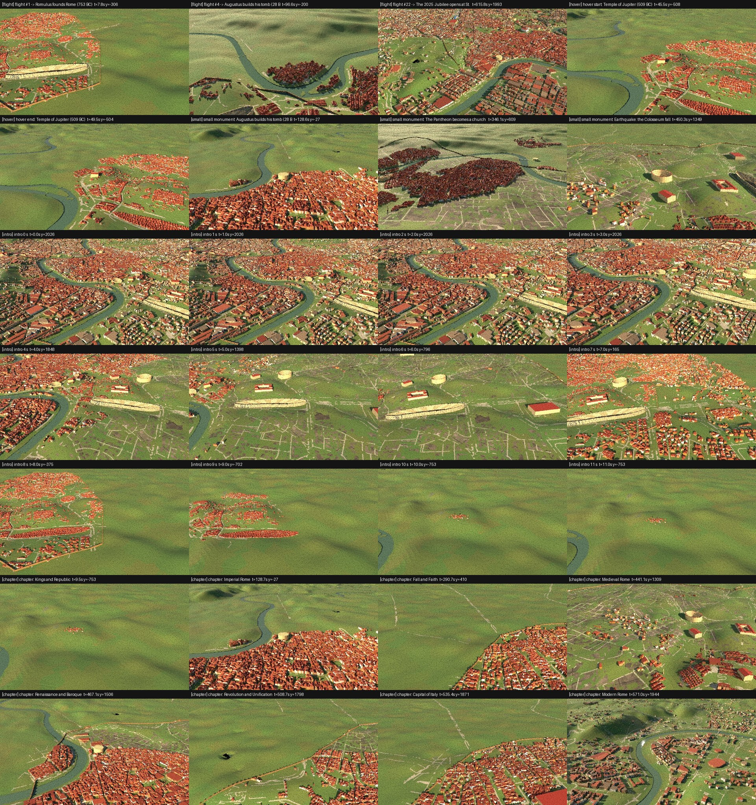
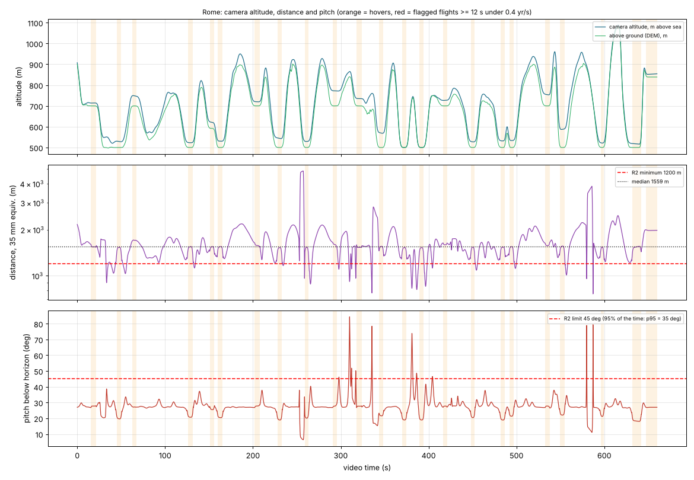
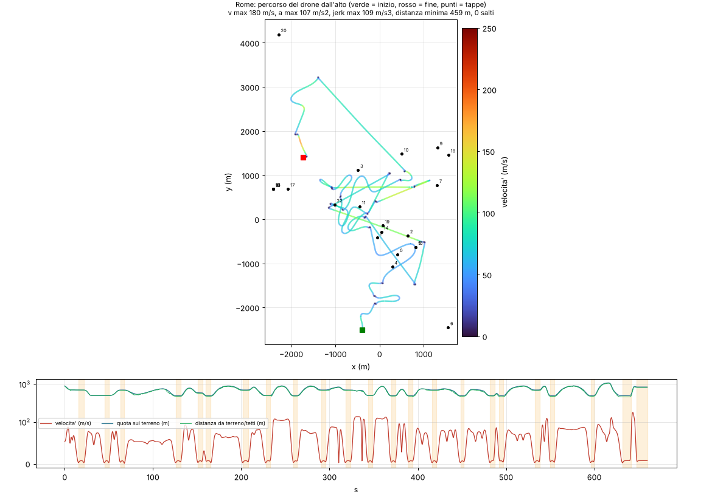
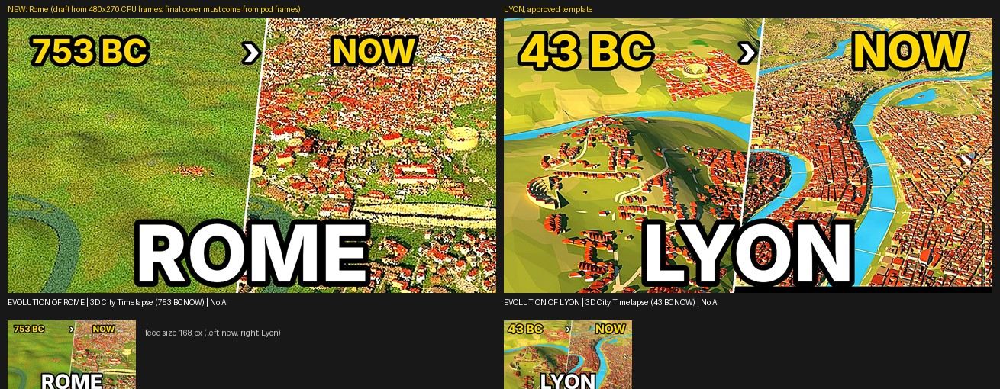

# GO dossier: Rome (roma)

Generated by `python -m kit gate roma` on 2026-11-27 15:28 in 1685 s. **Overall: WARN** (gate checks, including every kit qa FAIL) / kit qa alone: **WARN**. No pod before a written GO (R3).

## Verdict (R2)

- **PASS** R2 camera distance: median 1559 m (35 mm equiv.), minimum 1200; refs: Copenhagen 1397, Paris 1427
- **PASS** R2 look angle: p95 35 deg (limit 45), 98.5% of keys under it, max 84 deg
- **PASS** R2 frozen-counter flights: 0 flight(s) >= 12 s under 0.4 yr/s
- **PASS** plots: plots.png
- **PASS** POD PARITY: fresh unpack of data_roma_src + hist stub == local data: every json/npz md5 identical
- **PASS** contact sheet: 28/28 real local frames: contact_sheet.jpg
- **PASS** packaging draft: thumbnail + title built from the Lyon template
- **WARN** banner: 1 uncommitted changes that the pod will not see (e.g. M cities/roma/gate/contact_sheet.jpg)

## 1. Contact sheet (real local CPU frames, 480x270)



Frames: flight:flight #1 -> Romulus founds Rome (753 BC)@7.8s; flight:flight #4 -> Augustus builds his tomb (28 B@96.6s; flight:flight #22 -> The 2025 Jubilee opens at St. @615.8s; hover:hover start: Temple of Jupiter (509 BC)@45.5s; hover:hover end: Temple of Jupiter (509 BC)@49.5s; small:small monument: Augustus builds his tomb (28 B@128.6s; small:small monument: The Pantheon becomes a church @346.1s; small:small monument: Earthquake: the Colosseum fall@450.3s; intro:intro 0 s@0.0s; intro:intro 1 s@1.0s; intro:intro 2 s@2.0s; intro:intro 3 s@3.0s; intro:intro 4 s@4.0s; intro:intro 5 s@5.0s; intro:intro 6 s@6.0s; intro:intro 7 s@7.0s; intro:intro 8 s@8.0s; intro:intro 9 s@9.0s; intro:intro 10 s@10.0s; intro:intro 11 s@11.0s; chapter:chapter: Kings and Republic@9.5s; chapter:chapter: Imperial Rome@128.7s; chapter:chapter: Fall and Faith@290.7s; chapter:chapter: Medieval Rome@441.1s; chapter:chapter: Renaissance and Baroque@467.1s; chapter:chapter: Revolution and Unification@508.7s; chapter:chapter: Capital of Italy@535.4s; chapter:chapter: Modern Rome@571.0s

## 2. Camera altitude, distance, pitch





Median distance 1559 m (>= 1200); pitch p95 35 deg (< 45); max pitch 84 deg.

## 3. Flight table

| # | start s | end s | dur s | years/s | median dist m | max alt m | max pitch deg | to | flag |
|---|---|---|---|---|---|---|---|---|---|
| 1 | 0.0 | 15.7 | 15.7 | 177.01 | 1649 | 908 | 30 | Romulus founds Rome (753 BC) | (opening) |
| 2 | 21.7 | 45.0 | 23.3 | 9.68 | 1282 | 713 | 39 | Temple of Jupiter (509 BC) |  |
| 3 | 50.0 | 62.9 | 12.8 | 9.83 | 1284 | 749 | 34 | The Servian Wall (378 BC) |  |
| 4 | 67.3 | 125.9 | 58.6 | 5.87 | 1502 | 765 | 32 | Augustus builds his tomb (28 BC) |  |
| 5 | 131.3 | 151.1 | 19.7 | 4.58 | 1452 | 822 | 37 | The Great Fire of Rome (AD 64) |  |
| 6 | 156.1 | 159.6 | 3.5 | 3.45 | 1353 | 612 | 28 | The Colosseum (AD 72-80) |  |
| 7 | 165.6 | 201.9 | 36.3 | 5.20 | 1934 | 950 | 27 | The Aurelian Walls (271-275) |  |
| 8 | 207.9 | 227.9 | 20.0 | 1.45 | 1498 | 883 | 38 | The largest baths of all (306) |  |
| 9 | 232.7 | 259.2 | 26.5 | 1.86 | 2005 | 923 | 38 | Old St. Peter's (c. 320-360) |  |
| 10 | 263.2 | 290.6 | 27.4 | 1.68 | 1821 | 928 | 40 | Alaric sacks Rome (410) |  |
| 11 | 295.6 | 318.0 | 22.5 | 5.62 | 1545 | 865 | 84 | The Goths cut the aqueducts (537) |  |
| 12 | 324.0 | 343.7 | 19.6 | 3.61 | 1571 | 760 | 78 | The Pantheon becomes a church (609 |  |
| 13 | 348.5 | 369.9 | 21.4 | 8.88 | 1690 | 906 | 28 | Charlemagne crowned (800) |  |
| 14 | 374.7 | 389.5 | 14.8 | 10.90 | 1284 | 745 | 74 | Otto crowned emperor (962) |  |
| 15 | 394.3 | 416.4 | 22.1 | 8.18 | 1546 | 751 | 47 | The Senate returns (1143) |  |
| 16 | 421.2 | 448.3 | 27.2 | 7.56 | 1581 | 785 | 34 | Earthquake: the Colosseum falls (1 |  |
| 17 | 452.3 | 481.9 | 29.6 | 8.05 | 1490 | 757 | 38 | Michelangelo's dome (1590) |  |
| 18 | 486.9 | 491.8 | 4.8 | 16.12 | 1356 | 600 | 27 | Bernini's colonnade (1667-1676) |  |
| 19 | 496.6 | 532.6 | 36.1 | 5.29 | 1823 | 938 | 32 | Rome, capital of Italy (1871) |  |
| 20 | 538.0 | 549.6 | 11.6 | 3.15 | 1567 | 961 | 38 | The Vittoriano (1885-1911) |  |
| 21 | 554.6 | 595.9 | 41.2 | 1.12 | 1872 | 958 | 79 | Rome Olympics (1960) |  |
| 22 | 599.4 | 632.2 | 32.8 | 1.95 | 1782 | 1089 | 33 | The 2025 Jubilee opens at St. Pete |  |
| 23 | 641.8 | 647.5 | 5.7 | 0.03 | 1840 | 882 | 30 | finale | (finale) |

## 4. kit qa

Result: **WARN** (full report: qa_REPORT.md)

- **WARN** c) Republican and Imperial Rome within the Aurelian Walls nel 1500: 11352 edifici vivi (9/ha, copertura 15%) contro 10110 (8/ha, copertura 38%) nel 2026: rapporto 1.12
- **WARN** d) -653: 2 aree vuote allungate: #1 155x15 m a (41.89024,12.48048); #2 170x33 m a (41.88975,12.48301) — corridoi_-653.png
- **WARN** d) -653: 2 viali larghi gia' visibili (se aperti sventrando: gutting): #3 726x54 m a (41.88930,12.48217); #4 267x31 m a (41.89434,12.48224)
- **WARN** d) 1800: 3 corridoi accettati (FAIL -> WARN): #0 237x57 m a (41.90080,12.45091) — Vatican railway corridor (works 1929-1934, S54) inside the Vatican gardens, no houses before; ribbon appears at its date; #0 923x194 m a (41.89570,12.51033) — Termini rail yard: first station opened 1863 (S35) on the site of the Villa Montalto-Peretti; no houses stood there in 1800, so the empty strip is correct (rail ribbons start 1850s); #0 167x24 m a (41.88568,12.47942) — Tiber bank strip: Lungotevere embankment works ran 1876-1926 (S55); the ribbon here is dated 1900 by the data, so it is accepted until the road appears
- **WARN** d) 1800: 64 aree vuote allungate: #1 221x19 m a (41.90898,12.47389); #2 174x13 m a (41.90864,12.47377); #3 205x33 m a (41.90857,12.48463); #4 159x14 m a (41.90876,12.48666); #5 175x15 m a (41.90791,12.47292); #6 392x19 m a (41.90355,12.47324) — corridoi_1800.png
- **WARN** d) 1800: 13 viali larghi gia' visibili (se aperti sventrando: gutting): #65 4001x280 m a (41.89089,12.49148); #66 1175x59 m a (41.88850,12.47297); #67 1146x46 m a (41.90647,12.47386); #68 674x28 m a (41.90571,12.47186); #69 452x38 m a (41.89505,12.48226)
- **WARN** d) 1900: 1 corridoi accettati (FAIL -> WARN): #0 167x24 m a (41.88568,12.47942) — Tiber bank strip: Lungotevere embankment works ran 1876-1926 (S55); the ribbon here is dated 1900 by the data, so it is accepted until the road appears
- **WARN** d) 1900: 64 aree vuote allungate: #1 181x16 m a (41.90882,12.47403); #2 174x13 m a (41.90864,12.47377); #3 205x33 m a (41.90857,12.48463); #4 159x14 m a (41.90876,12.48666); #5 175x15 m a (41.90791,12.47292); #6 140x32 m a (41.90773,12.49445) — corridoi_1900.png
- **WARN** d) 1900: 22 viali larghi gia' visibili (se aperti sventrando: gutting): #65 3068x164 m a (41.88405,12.49141); #66 1177x59 m a (41.88850,12.47297); #67 1111x40 m a (41.90241,12.50674); #68 943x133 m a (41.89603,12.51000); #69 910x40 m a (41.90567,12.47386)
- **WARN** d) 1950: 63 aree vuote allungate: #1 181x16 m a (41.90882,12.47403); #2 174x13 m a (41.90864,12.47377); #3 205x33 m a (41.90857,12.48463); #4 159x14 m a (41.90876,12.48666); #5 175x15 m a (41.90791,12.47292); #6 140x33 m a (41.90773,12.49445) — corridoi_1950.png

## 5. Expected pod banner (quote it in the GO message)

```
VERSIONE: fd2ea51 Merge remote-tracking branch 'origin/main' into claude/prossima-citta-finire-2o3ryt | schedule_roma: 660 s, lens 32.0
```

Branch `claude/prossima-citta-finire-2o3ryt`. The GO message must contain, in ONE message: GPU check (`cuInit` = 0), `git pull` + this banner to verify, the launch command, the live progress one-liner, covers, and the condition to switch off (R3).

- WARN 1 uncommitted changes that the pod will not see (e.g. M cities/roma/gate/contact_sheet.jpg)

## 6. Cost (measured basis only, R4)

- Measured basis (Lyon, 16/11/2026) [Certain]: 29 pod-s per video-s (4 h 37 min real render / 565 s = 29.4), +30 min scene build per process (145K building groups), pod about 0.5 EUR/h [Likely: over 5 EUR for about 10 h].
- This city: video 11 min 00 s (660 s), 1 process(es) (day), buildings 92,562.
- **non misurato**: the city differs from Lyon by more than 25% in buildings (or the count is unknown). Range [Guessing]: 2 h 54 min to 8 h 58 min of pod (1.5 to 4.5 EUR), i.e. 0.5x-1.5x the Lyon seconds per video-s and 0.5x-2x the scene build. Measure on the first full render, do not quote one number.

## 7. Packaging (R14: series formula)

- Title: `EVOLUTION OF ROME | 3D City Timelapse (753 BC–NOW) | No AI`
- Lyon title (approved): `EVOLUTION OF LYON | 3D City Timelapse (43 BC–NOW) | No AI`
- Thumbnail: `753 BC > NOW`, city name `ROME`, two full halves, no flag.
- First-year hover frame and NOW frame come from the city json `cover.shots`; the draft is built from 480x270 CPU frames, the final cover is rendered on the pod frames.



