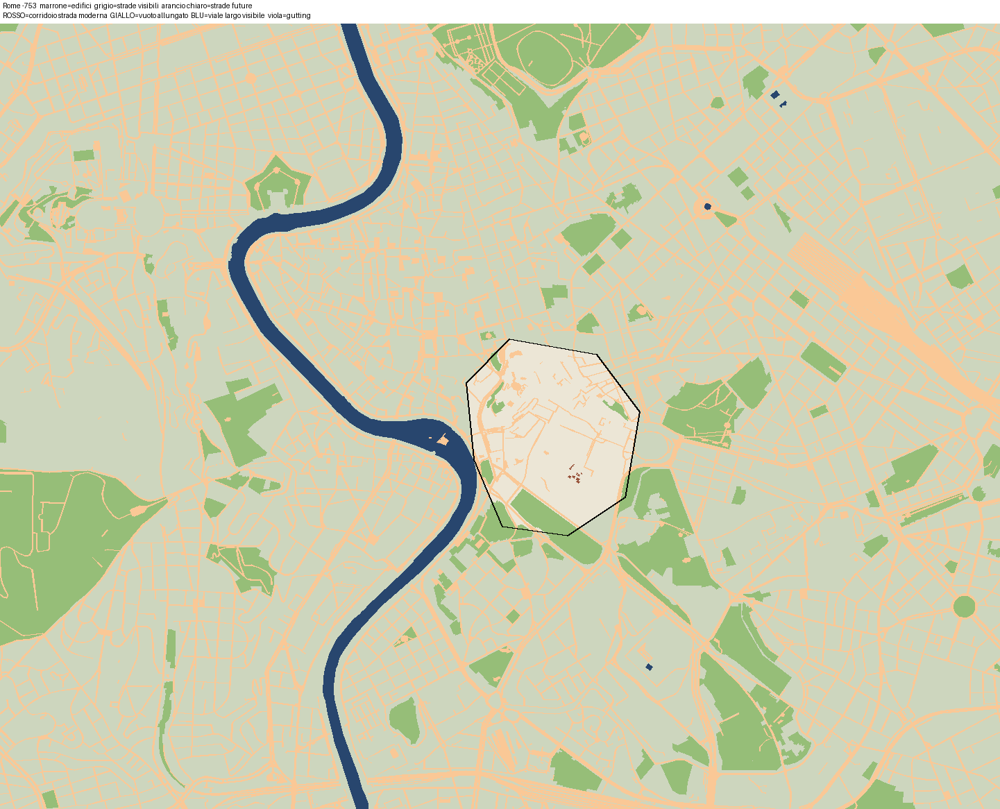
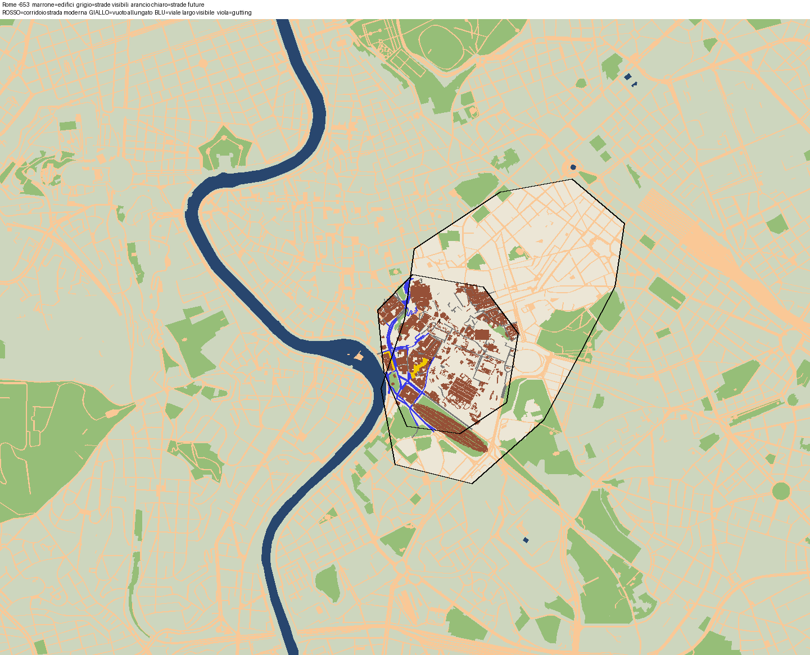
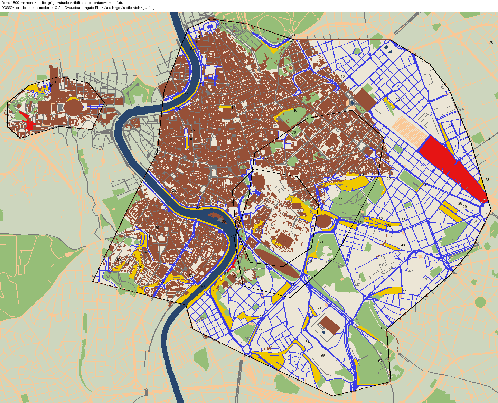
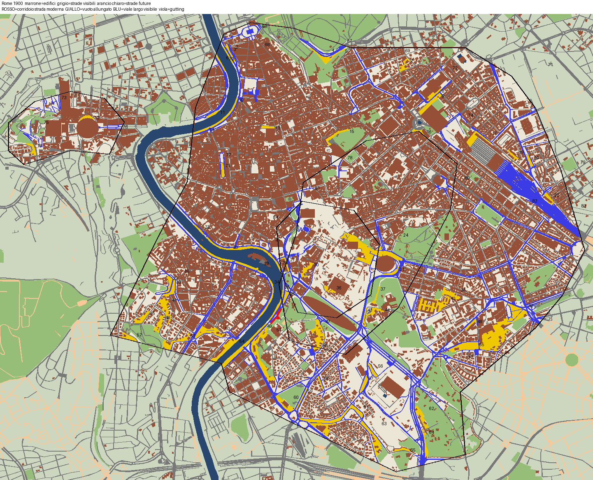
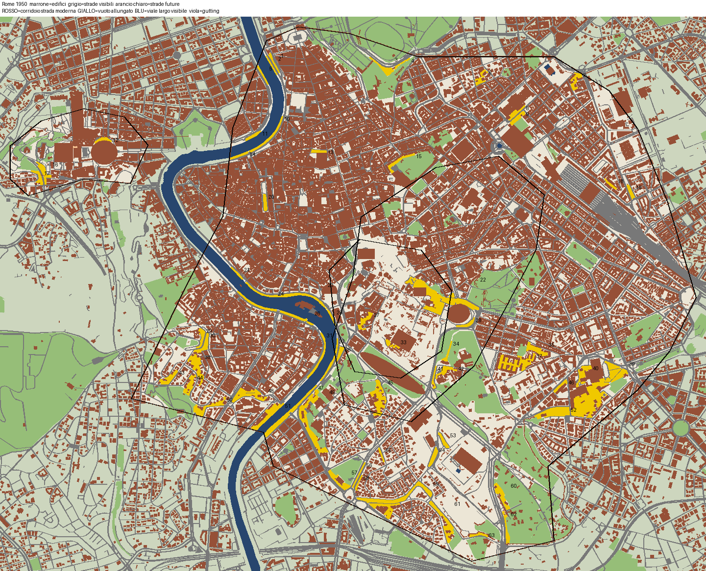

# QA roma

Generato da `python -m kit.qa` il 2026-11-27 08:01. Esito complessivo: **WARN**

| Sezione | Esito |
|---|---|
| a) Story e fonti | PASS |
| b) DATA | PASS |
| c) Densita' storica | WARN |
| d) Corridoi vuoti | WARN |
| e) Costo e schedule | WARN |

## a) Story e fonti

- **PASS** chiavi city
- **PASS** 70 fonti
- **PASS** date con fonte

## b) DATA

- **PASS** cartella DATA
  - data_roma
- **PASS** buildings.json
  - 92562 voci
- **PASS** roads.json
  - 44335 voci
- **PASS** hist.json
  - 67354 voci
- **PASS** land.json
  - 16 voci
- **PASS** landmarks.json
  - 1706 voci
- **PASS** dem.npz
- **PASS** anni edifici (92562)
  - senza anno 0, anno 0 (segnaposto): 0, dopo 2026: 0, prima di -753 (compaiono all'inizio): 0, d<=y: 0, ring<3: 0
- **PASS** hist (67354 predecessori)
  - senza y/d 0, d<y 0, nati dopo 2026: 0
- **PASS** anni strade (44335 nastri)
  - senza anno 0, dopo 2026: 0; visibili all'inizio 0, nel 1800 6028

## c) Densita' storica

- **PASS** First settlements: Palatine, Capitoline and Forum valley nel 1500
  - 1142 edifici vivi (13/ha, copertura 34%) contro 711 (8/ha, copertura 39%) nel 2026: rapporto 1.61
- **PASS** First settlements: Palatine, Capitoline and Forum valley nel 1800
  - 1290 edifici vivi (15/ha, copertura 38%) contro 711 (8/ha, copertura 39%) nel 2026: rapporto 1.81
- **PASS** Servian Rome (walled area, 246 ha) nel 1500
  - 2155 edifici vivi (9/ha, copertura 19%) contro 2136 (9/ha, copertura 38%) nel 2026: rapporto 1.01
- **PASS** Servian Rome (walled area, 246 ha) nel 1800
  - 3992 edifici vivi (16/ha, copertura 32%) contro 2136 (9/ha, copertura 38%) nel 2026: rapporto 1.87
- **WARN** Republican and Imperial Rome within the Aurelian Walls nel 1500
  - 11352 edifici vivi (9/ha, copertura 15%) contro 10110 (8/ha, copertura 38%) nel 2026: rapporto 1.12
- **PASS** Republican and Imperial Rome within the Aurelian Walls nel 1800
  - 15685 edifici vivi (12/ha, copertura 23%) contro 10110 (8/ha, copertura 38%) nel 2026: rapporto 1.55
- **PASS** Vatican and Leonine City nel 1500
  - 1599 edifici vivi (28/ha, copertura 40%) contro 403 (7/ha, copertura 51%) nel 2026: rapporto 3.97
- **PASS** Vatican and Leonine City nel 1800
  - 1273 edifici vivi (23/ha, copertura 53%) contro 403 (7/ha, copertura 51%) nel 2026: rapporto 3.16

## d) Corridoi vuoti

- **PASS** -753: nessun corridoio vuoto
  - corridoi_-753.png
- **WARN** -653: 2 aree vuote allungate
  - #1 155x15 m a (41.89024,12.48048); #2 170x33 m a (41.88975,12.48301) — corridoi_-653.png
- **WARN** -653: 2 viali larghi gia' visibili (se aperti sventrando: gutting)
  - #3 726x54 m a (41.88930,12.48217); #4 267x31 m a (41.89434,12.48224)
- **WARN** 1800: 3 corridoi accettati (FAIL -> WARN)
  - #0 237x57 m a (41.90080,12.45091) — Vatican railway corridor (works 1929-1934, S54) inside the Vatican gardens, no houses before; ribbon appears at its date; #0 923x194 m a (41.89570,12.51033) — Termini rail yard: first station opened 1863 (S35) on the site of the Villa Montalto-Peretti; no houses stood there in 1800, so the empty strip is correct (rail ribbons start 1850s); #0 167x24 m a (41.88568,12.47942) — Tiber bank strip: Lungotevere embankment works ran 1876-1926 (S55); the ribbon here is dated 1900 by the data, so it is accepted until the road appears
- **WARN** 1800: 64 aree vuote allungate
  - #1 221x19 m a (41.90898,12.47389); #2 174x13 m a (41.90864,12.47377); #3 205x33 m a (41.90857,12.48463); #4 159x14 m a (41.90876,12.48666); #5 175x15 m a (41.90791,12.47292); #6 392x19 m a (41.90355,12.47324) — corridoi_1800.png
- **WARN** 1800: 13 viali larghi gia' visibili (se aperti sventrando: gutting)
  - #65 4001x280 m a (41.89089,12.49148); #66 1175x59 m a (41.88850,12.47297); #67 1146x46 m a (41.90647,12.47386); #68 674x28 m a (41.90571,12.47186); #69 452x38 m a (41.89505,12.48226)
- **WARN** 1900: 1 corridoi accettati (FAIL -> WARN)
  - #0 167x24 m a (41.88568,12.47942) — Tiber bank strip: Lungotevere embankment works ran 1876-1926 (S55); the ribbon here is dated 1900 by the data, so it is accepted until the road appears
- **WARN** 1900: 64 aree vuote allungate
  - #1 181x16 m a (41.90882,12.47403); #2 174x13 m a (41.90864,12.47377); #3 205x33 m a (41.90857,12.48463); #4 159x14 m a (41.90876,12.48666); #5 175x15 m a (41.90791,12.47292); #6 140x32 m a (41.90773,12.49445) — corridoi_1900.png
- **WARN** 1900: 22 viali larghi gia' visibili (se aperti sventrando: gutting)
  - #65 3068x164 m a (41.88405,12.49141); #66 1177x59 m a (41.88850,12.47297); #67 1111x40 m a (41.90241,12.50674); #68 943x133 m a (41.89603,12.51000); #69 910x40 m a (41.90567,12.47386)
- **WARN** 1950: 63 aree vuote allungate
  - #1 181x16 m a (41.90882,12.47403); #2 174x13 m a (41.90864,12.47377); #3 205x33 m a (41.90857,12.48463); #4 159x14 m a (41.90876,12.48666); #5 175x15 m a (41.90791,12.47292); #6 140x33 m a (41.90773,12.49445) — corridoi_1950.png

## e) Costo e schedule

- **PASS** costo dei cambi (5 s)
  - oggetti citta' 1749, cambi in tutto il video 50639, max in un fotogramma 362 (~4 s), costo dei soli cambi ~0.17 h (budget 1.0 h)
- **PASS** drone: velocita' massima
  - 117 m/s (limite 250), mediana 18
- **PASS** drone: accelerazione massima
  - 91 m/s2 (limite 120), 99% 36
- **PASS** drone: jerk massimo
  - 81 m/s3 (limite 200), 99% 37
- **PASS** drone: distanza minima da terreno e tetti
  - 460 m (soglia 24); dal solo terreno 500 m
- **PASS** drone: discontinuita' (target 0, tagli dichiarati: 0)
  - 0 salti
- **PASS** drone: soste tolte per tempo
  - 0 tolte, 16 tenute, 0 solo sorvolate; hover 81 s, volo 551 s; 
- **PASS** drone: hover quasi fermo
  - v max in hover 8.1 m/s (soglia 12; esclusi 30% o 1,5 s a ogni estremo)
- **PASS** drone: voli con gli anni quasi fermi
  - nessun volo >= 12 s sotto 0,4 anni/s (fuori da apertura e finale)  [uniscili: trasforma una delle due soste vicine in cartello]
- **PASS** drone: monumenti visibili durante il loro hover
  - ogni monumento bersaglio ha il corpo costruito a meta' hover  [Confluences: il corpo compariva a fine hover]
- **PASS** drone: distanza della camera
  - mediana 1559 m equivalenti a 35 mm (obiettivo 32 mm); riferimenti: Copenaghen 1397, Parigi 1427, Madrid 2538, Lione 930 (giudicata troppo vicina); soglia 1200
- **PASS** drone: esattezza anni
  - soste: y0 e y1 esatti sulla finestra di hover; cartelli fuori hover esatti; cartelli durante un hover e voli: anni flessibili (il contatore scorre fra le voci)
- **PASS** drone: grafico del percorso
  - qa/drone_path.png
- **WARN** ritmo: nessun vuoto > 15 s senza stimolo nuovo
  - vuoto massimo 22.6 s (373-396 s); 5 oltre 15 s: 16-32, 241-257, 338-356, 373-396, 396-418
- **PASS** ritmo: anni/s per minuto
  - 0:00 40.27 | 1:00  5.13 | 2:00  3.39 | 3:00  3.48 | 4:00  2.08 | 5:00  5.02 | 6:00  9.22 | 7:00  6.51 | 8:00  3.59 | 9:00  1.08 | 10:00  0.77
- **PASS** 16 soste ben formate
- **PASS** soste ordinate e non sovrapposte
- **PASS** didascalie "Titolo (data)"
- **PASS** soste e cartelli sugli anni della story (0,01)
- **PASS** evento forte entro 45 s
  - primo a 15.7 s

## Immagini

