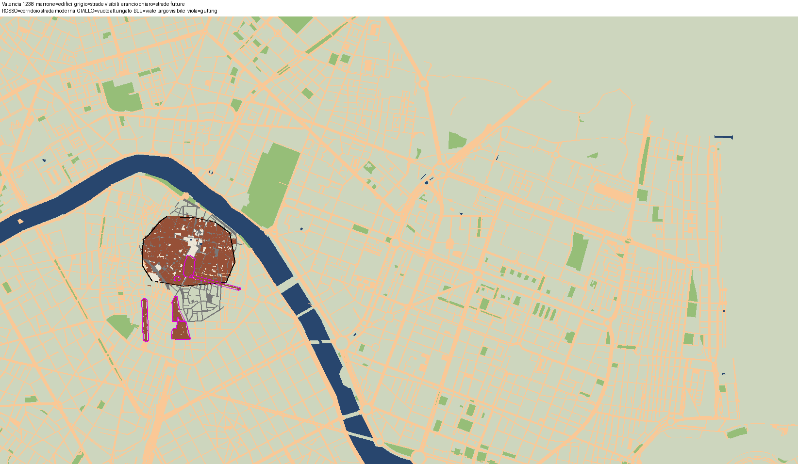
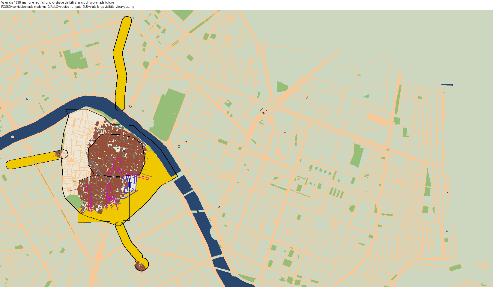
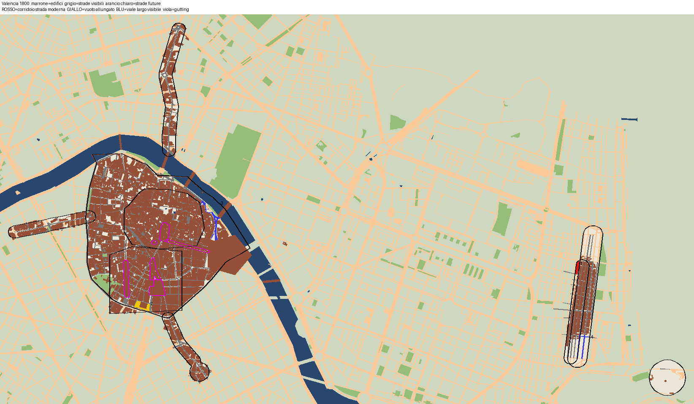
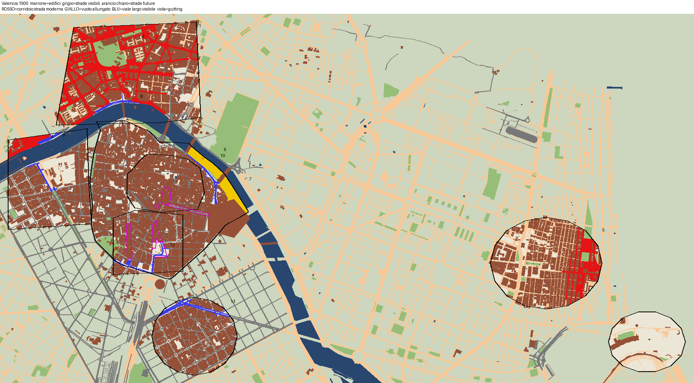
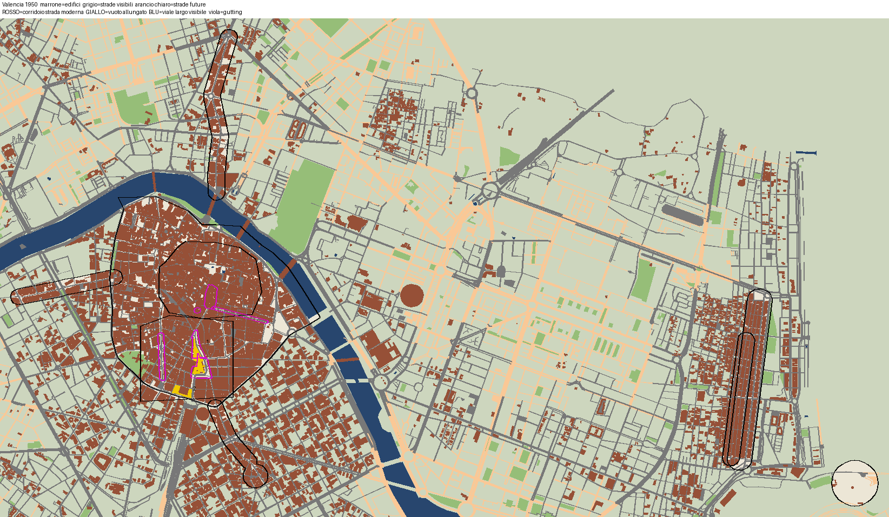

# QA valencia

Generato da `python -m kit.qa` il 2026-11-12 13:54. Esito complessivo: **WARN**

| Sezione | Esito |
|---|---|
| a) Story e fonti | WARN |
| b) DATA | PASS |
| c) Densita' storica | PASS |
| d) Corridoi vuoti | WARN |
| e) Costo e schedule | PASS |

## a) Story e fonti

- **PASS** chiavi city
- **PASS** 56 fonti
- **PASS** date con fonte
- **WARN** date fuori dall'intervallo del video
  - history.water[3] Jardi del Turia 1: 99999; history.water[5] Jardi del Turia 2: 99999; history.water[7] Jardi del Turia 3: 99999; history.water[9] Jardi del Turia 4: 99999; history.water[11] Jardi del Turia 5: 99999; history.water[13] Jardi del Turia 6: 99999

## b) DATA

- **PASS** cartella DATA
  - data_valencia
- **PASS** buildings.json
  - 38240 voci
- **PASS** roads.json
  - 13838 voci
- **PASS** hist.json
  - 9367 voci
- **PASS** land.json
  - 4 voci
- **PASS** landmarks.json
  - 1664 voci
- **PASS** dem.npz
- **PASS** anni edifici (38240)
  - senza anno 0, dopo 2026: 0, prima di 1238 (compaiono all'inizio): 0, d<=y: 0, ring<3: 0
- **PASS** hist (9367 predecessori)
  - senza y/d 0, d<y 0, nati dopo 2026: 0
- **PASS** anni strade (13838 nastri)
  - senza anno 0, dopo 2026: 0; visibili all'inizio 344, nel 1800 984

## c) Densita' storica

- **PASS** Muslim walled city nel 1238
  - 1920 edifici vivi (53/ha, copertura 65%) contro 1054 (29/ha, copertura 76%) nel 2026: rapporto 1.82
- **PASS** Muslim walled city nel 1500
  - 1904 edifici vivi (53/ha, copertura 72%) contro 1054 (29/ha, copertura 76%) nel 2026: rapporto 1.81
- **PASS** Muslim walled city nel 1800
  - 1744 edifici vivi (48/ha, copertura 76%) contro 1054 (29/ha, copertura 76%) nel 2026: rapporto 1.65
- **PASS** Boatella quarter (inside 1356 wall) nel 1500
  - 1944 edifici vivi (48/ha, copertura 61%) contro 668 (17/ha, copertura 62%) nel 2026: rapporto 2.91
- **PASS** Boatella quarter (inside 1356 wall) nel 1800
  - 1944 edifici vivi (48/ha, copertura 61%) contro 668 (17/ha, copertura 62%) nel 2026: rapporto 2.91
- **PASS** Christian expansion within the 1356 wall nel 1500
  - 7123 edifici vivi (44/ha, copertura 57%) contro 3281 (20/ha, copertura 60%) nel 2026: rapporto 2.17
- **PASS** Christian expansion within the 1356 wall nel 1800
  - 6803 edifici vivi (42/ha, copertura 65%) contro 3281 (20/ha, copertura 60%) nel 2026: rapporto 2.07
- **PASS** Quart suburb (arrabal de Quart) nel 1800
  - 355 edifici vivi (37/ha, copertura 54%) contro 242 (25/ha, copertura 56%) nel 2026: rapporto 1.47
- **PASS** Morvedre suburb (north of the Turia) nel 1800
  - 491 edifici vivi (32/ha, copertura 41%) contro 186 (12/ha, copertura 54%) nel 2026: rapporto 2.64
- **PASS** Russafa village nel 1800
  - 300 edifici vivi (35/ha, copertura 55%) contro 142 (17/ha, copertura 58%) nel 2026: rapporto 2.11
- **PASS** El Grau (Vilanova del Grau) nel 1800
  - 7 edifici vivi (1/ha, copertura 1%) contro 7 (1/ha, copertura 1%) nel 2026: rapporto 1.00

## d) Corridoi vuoti

- **PASS** 1238: nessun corridoio vuoto
  - corridoi_1238.png
- **WARN** 1338: 4 aree vuote allungate
  - #1 1212x126 m a (39.48675,-0.37460); #2 1415x313 m a (39.46943,-0.37378); #3 679x118 m a (39.47504,-0.38856); #4 153x32 m a (39.47104,-0.37339) — corridoi_1338.png
- **WARN** 1338: 1 viali larghi gia' visibili (se aperti sventrando: gutting)
  - #5 304x52 m a (39.47179,-0.37353)
- **WARN** 1800: 1 corridoi accettati (FAIL -> WARN)
  - #0 120x24 m a (39.47144,-0.32993) — modern street through the 19th-century Cabanyal strip; accepted
- **WARN** 1800: 1 aree vuote allungate
  - #1 169x33 m a (39.46813,-0.37793) — corridoi_1800.png
- **WARN** 1800: 2 viali larghi gia' visibili (se aperti sventrando: gutting)
  - #2 391x22 m a (39.47546,-0.37039); #3 241x26 m a (39.46464,-0.32928)
- **WARN** 1900: 1 aree vuote allungate
  - #1 169x33 m a (39.46813,-0.37793) — corridoi_1900.png
- **WARN** 1900: 2 viali larghi gia' visibili (se aperti sventrando: gutting)
  - #2 524x31 m a (39.46896,-0.37851); #3 396x26 m a (39.47546,-0.37039)
- **WARN** 1950: 2 aree vuote allungate
  - #1 225x53 m a (39.47048,-0.37648); #2 169x33 m a (39.46813,-0.37793) — corridoi_1950.png

## e) Costo e schedule

- **PASS** costo dei cambi (3 s)
  - oggetti citta' 1539, cambi in tutto il video 67138, max in un fotogramma 406 (~5 s), costo dei soli cambi ~0.22 h (budget 1.0 h)
- **PASS** 25 soste ben formate
- **PASS** soste ordinate e non sovrapposte
- **PASS** didascalie "Titolo (data)"
- **PASS** soste e cartelli sugli anni della story (0,01)
- **PASS** evento forte entro 45 s
  - primo a 12.9 s
- **PASS** notte
  - night_t=460.5, schedule_valencia_night.json ok

## Immagini

