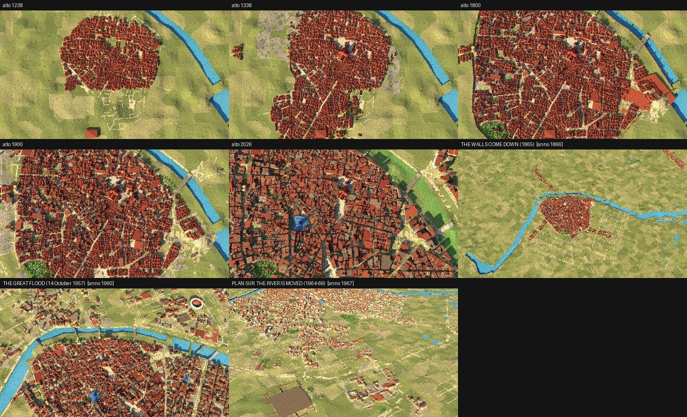

# QA valencia

Generato da `python -m kit.qa` il 2026-11-12 12:17. Esito complessivo: **PASS**

| Sezione | Esito |
|---|---|
| f) Fotogrammi locali | PASS |

## f) Fotogrammi locali

- **PASS** render locale: 8 fotogrammi in 190 s
  - cities/valencia/qa/render.log
- **PASS** foglio contatti
  - cities/valencia/qa/contact.jpg: guardalo prima del pod (strade come nastri chiari, centro pieno)

## Immagini

